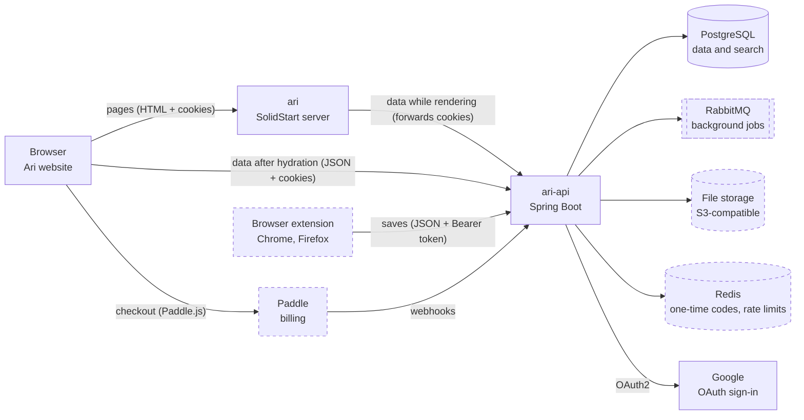

# ari-api architecture

Last updated 2026-10-08. The server side of Ari: how `ari-api` connects to its callers and
services, its sign-in rules and error codes, and how to build it. Read it together with
`.claude/skills/ari-api/SKILL.md`. If they ever disagree, ask before writing code.

| File | What it shows |
|---|---|
| `architecture.md` (this file) | How ari-api connects, sign-in rules, error codes, implementation guide |
| [`sequences.md`](sequences.md) | Step by step: sign-in, refresh, library page, saving, imports, extension, billing |
| [`database.md`](database.md) | Every table, column and relation |

Feature numbers (F1, F8, F9…) match the GitHub issues on the "Ari" project board.

## 1. System overview

Dashed boxes are later features. Accounts and sessions live in PostgreSQL (F1, F9); the library
endpoints get their tables when their features are built.

Key decisions:

- `ari-api` is a JSON API with three callers: the `ari` server while it renders pages (it forwards
  the browser's cookies), the browser after hydration (cookies, with CORS allowing the web origin
  and credentials), and the extension (F13, `Authorization: Bearer`).
- Only `ari-api` talks to PostgreSQL, RabbitMQ, file storage, Redis and Google, and only `ari-api`
  receives Paddle webhooks. Only the webhook changes a user's plan.
- Long work runs in the background: file imports go through the outbox, RabbitMQ and a consumer
  inside `ari-api` ([sequences §6](sequences.md#6-pdf-or-word-import-f11)).
- Local URLs: API `http://localhost:8080`, base path `/api/v1`, web origin `http://localhost:3000`.
  Cookies ignore the port, so the `ari` server receives the cookies `ari-api` sets on `localhost`.
  In production the two apps run on sibling subdomains and the cookies set `Domain` to the shared
  parent domain (F16).

## 2. Configuration

Every value comes from an environment variable (locally from `.env`, see `.env.example`).

| Variable | Default | Meaning |
|---|---|---|
| `DB_URL`, `DB_USERNAME` | `jdbc:postgresql://localhost:5432/ari`, `ari` | PostgreSQL; `docker compose up -d postgres` starts one |
| `DB_PASSWORD` | none (required) | Also sets the password of the compose `postgres` service |
| `APP_JWT_SECRET` | none (required) | HS256 key for access tokens, at least 32 characters (`openssl rand -base64 48`) |
| `APP_COOKIE_SECURE` | `true` | `false` only for `http://localhost` |
| `APP_COOKIE_DOMAIN` | blank | Shared parent domain in production; blank keeps cookies on the API host |
| `APP_WEB_URL` | `http://localhost:3000` | The website; Google sign-in sends users back there |
| `APP_SEED_DEMO_DATA` | `false` | Adds `demo@example.com` / `demo1234`; local development and tests only |
| `GOOGLE_CLIENT_ID`, `GOOGLE_CLIENT_SECRET` | blank | Google sign-in is off while either is blank |

## 3. Sign-in rules

| Rule | Value |
|---|---|
| Access cookie | `ari_access`: JWT, HS256, 15 minutes, claims `iss` (`ari-api`), `sub` (user id), `email`, `plan`. Cookie `Max-Age` 14 minutes, so a cookie the browser still sends never holds an expired JWT |
| Refresh cookie | `ari_refresh`: 32 random bytes, 30 days from the last refresh, replaced on every refresh |
| Cookie flags | Both: `Path=/`, `HttpOnly`, `SameSite=Lax`, `Secure` outside local http, `Domain` = shared parent domain in production. `Path=/` lets the `ari` server send `ari_refresh` and refresh while rendering ([sequences §2](sequences.md#2-token-refresh-f1)) |
| Reuse detection | A replaced refresh token used again within 10 seconds still gets a new pair, while its session has an active token (a server render and a browser call refreshing at once). Otherwise using it revokes its whole session. Logout stays final |
| Refresh fails | 401 `UNAUTHORIZED`, and both cookies are cleared; only the API can delete httpOnly cookies |
| Passwords | 8 characters to 72 bytes (bcrypt's limit), stored as bcrypt hashes |
| Login answers | `INVALID_CREDENTIALS` for every failure, and unknown emails run a bcrypt check too, so neither the answer nor its timing reveals which emails exist |
| Stored secrets | Only the SHA-256 hash of a refresh token |
| Logout | `POST /api/v1/auth/logout` revokes the session and clears both cookies (always 204) |
| Stale cookies | The sign-in endpoints (`/api/v1/auth/**`) ignore `ari_access`, so an old cookie never blocks signing in |
| Google | Matched by Google's `sub`. A new email gets a user without a password. An existing email is linked; if it was never verified, its password is removed and its sessions are revoked, because Google just proved who owns it. Refused, back to `/login?error=google`: an email Google hasn't verified, a user who already has another Google account, a cancelled consent or a bad `state` |
| Extension | Same token rules, but the tokens travel in JSON bodies and `Authorization: Bearer`, never in cookies. Its refresh tokens are stored with `client = EXTENSION` |

## 4. Error codes

Every error is an RFC 9457 Problem Detail with a stable `code`.

| Code | Status | When |
|---|---|---|
| `VALIDATION_FAILED` | 400 | Bad body, query or upload (file type or size) |
| `UNAUTHORIZED` | 401 | Missing, expired or invalid token, sign-in code or webhook signature |
| `INVALID_CREDENTIALS` | 401 | Wrong email or password, or a Google-only user without a password |
| `LIMIT_REACHED` | 403 | A Free user already stores 500 highlights |
| `NOT_FOUND` | 404 | The item does not exist or belongs to another user |
| `EMAIL_TAKEN` | 409 | Register with an email that is already used |

## 5. How it is built

Work one feature at a time, and give a plan before writing code. `feature/account` (F1, F9) is the
first real module; copy its patterns.

**Persistence (the pattern for every feature)**

- Liquibase creates the tables at startup from `resources/db/changelog/` (files listed in
  [database.md](database.md#4-changesets)). Never edit an applied file; add the next numbered one.
- A domain port (`UserRepository`) gets a MyBatis adapter in `infrastructure/`: a `@Mapper`
  interface that extends the port (`UserMyBatisRepository`) plus its SQL in
  `resources/persistence/UserMyBatisRepository.xml`. Rows map straight into the domain records by
  constructor argument name (`password_hash` → `passwordHash`).
- `common/handlers` holds the type handlers: `Instant` ↔ `timestamptz` in UTC, `UUID` ↔ `uuid`.
- Uniqueness is the database's job: inserts use `ON CONFLICT DO NOTHING` and return `false` when a
  unique key already exists; `revoke` matches only `revoked_at IS NULL`, so two parallel refreshes
  of one token can't both win.
- Services return `Optional` or `boolean`; facades turn "empty" into feature exceptions
  (`application/exception/`). `@Transactional` goes on facade use cases, except where a failed
  request must keep its writes: refresh and logout commit inside `TokenService`, so reuse detection
  stays in force after its 401.

**F1 Sign in**

- `config/SecurityConfig`, API chain: stateless, CSRF off (`SameSite=Lax` cookies plus CORS), CORS
  with credentials for `APP_CORS_ALLOWED_ORIGINS`. Public: `/api/v1/auth/**`, `/actuator/health`,
  Swagger and `/error`. Everything else needs a valid JWT; a missing or bad one gets a 401 Problem
  Detail from `ProblemDetailsAuthenticationEntryPoint`.
- JWTs: `NimbusJwtEncoder` / `NimbusJwtDecoder`, HS256 with `APP_JWT_SECRET`, issuer `ari-api`.
  The decoder checks expiry with the injected `Clock`. `CookieBearerTokenResolver` reads
  `ari_access`, then the `Authorization` header, and nothing on `/api/v1/auth/**`.
- `TokenService` creates and rotates tokens; `AccountControllerImpl` turns them into cookies through
  `AuthCookies`.
- `DemoUserSeeder` adds the demo user when `APP_SEED_DEMO_DATA=true`, so production never has one.

**F9 Google sign-in**

- A second filter chain covers only `/oauth2/**` and `/login/oauth2/**`. It may use a short session
  to remember the OAuth `state`; the API chain stays stateless. Its `oauth2Login` exists only when
  `GOOGLE_CLIENT_ID` and `GOOGLE_CLIENT_SECRET` are set; otherwise those URLs answer 404, so CI and
  fresh clones need no Google credentials.
- The client registration is built in code from `CommonOAuth2Provider.GOOGLE` (scopes `openid`,
  `email`, `profile`), not from Spring Boot's `spring.security.oauth2.client.*` properties, which
  would fail at startup when blank. In Google Cloud, register the redirect URL
  `http://localhost:8080/login/oauth2/code/google`.
- `GoogleSignInSuccessHandler` reads the ID token (`sub`, `email`, `email_verified`, `name`), applies
  the rules in section 3, sets the same two cookies as a password sign-in, ends the handshake session
  and redirects to `{APP_WEB_URL}/library`. Every refusal or handshake failure redirects to
  `{APP_WEB_URL}/login?error=google`.

### Tests that prove it works

`./gradlew check` runs them against a PostgreSQL 18 container (Testcontainers; Docker must be
running):

- `AccountControllerTest`: register and login set both cookies with their flags; a taken email in
  any case is 409; bad input and passwords over 72 bytes are 400; `/me` works with the cookie or a
  Bearer header and is 401 without one or after 15 minutes; refresh rotates; a replaced token works
  for 10 seconds and then revokes its session; logout clears the cookies and ends the session; a
  stale cookie doesn't block login; the CORS preflight allows credentials.
- `GoogleSignInTest`: new, returning, linked (verified and unverified) and refused Google users; the
  redirect to Google; the success and failure handlers.
- `AriApiApplicationTests`: Liquibase creates the tables, health is UP, Google is off without
  credentials. `ArchitectureTest`: the layer rules from SKILL.md.
