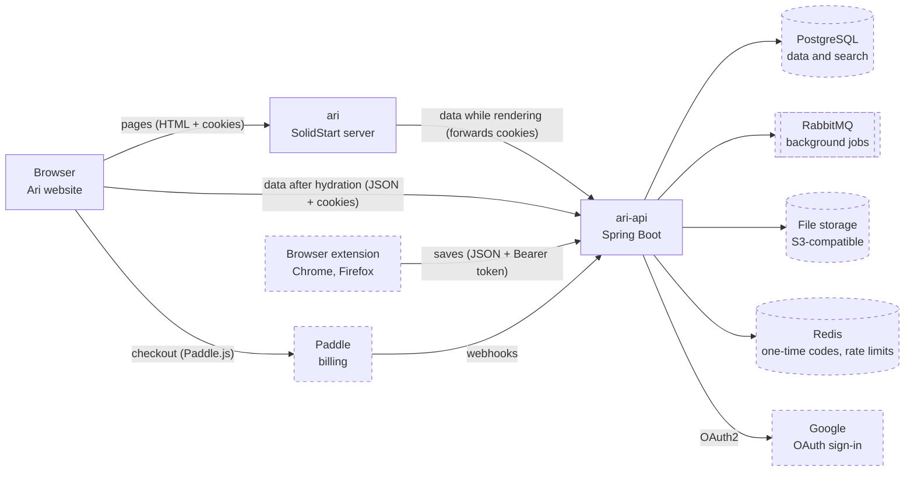

# ari-api architecture

Last updated 2026-10-08. The server side of Ari: how `ari-api` connects to its callers and
services, its sign-in rules and error codes, and how to build it. Read it together with
`.claude/skills/ari-api/SKILL.md`. If they ever disagree, ask before writing code.

| File | What it shows |
|---|---|
| `architecture.md` (this file) | How ari-api connects, sign-in rules, error codes, implementation guide |
| [`sequences.md`](sequences.md) | Step by step: sign-in, refresh, library page, saving, imports, extension, billing |
| [`database.md`](database.md) | Every table, column and relation |

Feature numbers (F1, F8, F9…) match the GitHub issues on the "Ari" project board.

## 1. System overview

Dashed boxes are later features. In phase 1, `ari-api` keeps all data in memory.

Key decisions:

- `ari-api` is a JSON API with three callers: the `ari` server while it renders pages (it forwards
  the browser's cookies), the browser after hydration (cookies, with CORS allowing the web origin
  and credentials), and the extension (F13, `Authorization: Bearer`).
- Only `ari-api` talks to PostgreSQL, RabbitMQ, file storage, Redis and Google, and only `ari-api`
  receives Paddle webhooks. Only the webhook changes a user's plan.
- Long work runs in the background: file imports go through the outbox, RabbitMQ and a consumer
  inside `ari-api` ([sequences §6](sequences.md#6-pdf-or-word-import-f11)).
- Local URLs: API `http://localhost:8080`, base path `/api/v1`, web origin `http://localhost:3000`.
  Cookies ignore the port, so the `ari` server receives the cookies `ari-api` sets on `localhost`.
  In production the two apps run on sibling subdomains and the cookies set `Domain` to the shared
  parent domain (F16).

## 2. Sign-in rules

| Rule | Value |
|---|---|
| Access cookie | `ari_access`: JWT, HS256, 15 minutes, claims `sub` (user id), `email`, `plan`. Cookie `Max-Age` 14 minutes, so a cookie the browser still sends never holds an expired JWT |
| Refresh cookie | `ari_refresh`: 32 random bytes, 30 days, replaced on every refresh |
| Cookie flags | Both: `Path=/`, `HttpOnly`, `SameSite=Lax`, `Secure` outside dev, `Domain` = shared parent domain in production. `Path=/` lets the `ari` server send `ari_refresh` and refresh while rendering ([sequences §2](sequences.md#2-token-refresh-f1)) |
| Reuse detection | A replaced refresh token used again within 10 seconds still gets a new pair (a server render and a browser call refreshing at once). After that, using it revokes its whole family |
| Stored secrets | Only the SHA-256 hash of a refresh token; passwords as bcrypt hashes |
| Logout | `POST /api/v1/auth/logout` revokes the refresh token and clears both cookies (204) |
| Extension | Same token rules, but the tokens travel in JSON bodies and `Authorization: Bearer`, never in cookies. Its refresh tokens are stored with `client = EXTENSION` |

## 3. Error codes

Every error is an RFC 9457 Problem Detail with a stable `code`.

| Code | Status | When |
|---|---|---|
| `VALIDATION_FAILED` | 400 | Bad body, query or upload (file type or size) |
| `UNAUTHORIZED` | 401 | Missing, expired or invalid token, sign-in code or webhook signature |
| `INVALID_CREDENTIALS` | 401 | Wrong email or password, or a Google-only user without a password |
| `LIMIT_REACHED` | 403 | A Free user already stores 500 highlights |
| `NOT_FOUND` | 404 | The item does not exist or belongs to another user |
| `EMAIL_TAKEN` | 409 | Register with an email that is already used |

## 4. Implementation guide for Claude Code

Work one feature at a time, and give a plan before writing code.

**F1 Sign in (phase 1, no database yet)**

- Put everything in `feature/account`, following the reference module layout. Domain models `User`
  and `RefreshToken` have exactly the columns from [database.md](database.md). Ports
  `UserRepository` and `RefreshTokenRepository` get in-memory adapters in `infrastructure/`. The
  database step (F8) then only swaps adapters.
- Seed the demo user `demo@example.com` / `demo1234`.
- `config/SecurityConfig`: stateless; CSRF off; CORS with credentials for `http://localhost:3000`.
  Public: `/api/v1/auth/**`, `/actuator/health`, `/swagger-ui/**`, `/v3/api-docs/**`. Everything else
  needs a valid JWT. Return a 401 Problem Detail through a custom `AuthenticationEntryPoint`.
- JWTs: `NimbusJwtEncoder` / `NimbusJwtDecoder` with an HS256 key from `app.jwt.secret`. A custom
  `BearerTokenResolver` reads the `ari_access` cookie first, then the `Authorization` header.
- Services (`AuthService`, `TokenService`) return tokens; `AccountControllerImpl` writes both cookies
  with `ResponseCookie` and `Path=/`.
- Refresh: hash the incoming token and look it up. Missing or expired: 401. Already revoked less
  than 10 seconds ago: issue a new pair in the same family. Revoked earlier: revoke the whole family,
  then 401. Otherwise revoke it and issue a new pair with the same `family_id`.
- Login answers `INVALID_CREDENTIALS` for every failure, including Google-only users without a
  password, so it never reveals which emails exist.

**F8 Database**

- Liquibase changesets as listed in [database.md](database.md#4-changesets), included from the master
  file.
- MyBatis adapters (`UserMyBatisRepository` and friends) with XML mappers in `resources/persistence/`;
  keep the in-memory adapters behind the `mock` profile.

**F9 Google sign-in**

- `spring-boot-starter-oauth2-client` with `client-id` and `client-secret` from the environment
  variables `GOOGLE_CLIENT_ID` and `GOOGLE_CLIENT_SECRET`; scopes `openid`, `email`, `profile`. In
  Google Cloud, register the redirect URL `http://localhost:8080/login/oauth2/code/google`.
- A custom success handler reads the user's `sub`, email, `email_verified` and name. It finds the
  user by `(GOOGLE, sub)`, links an existing user only when the email is verified, or creates a new
  user (no password, `email_verified_at` set). Then it sets the same two cookies and redirects to
  `http://localhost:3000/library`. On failure it redirects to `/login?error=google`.
- The OAuth2 handshake must remember `state` between the redirect and the callback. Allow a session
  only for `/oauth2/**` and `/login/oauth2/**` (a separate filter chain with `IF_REQUIRED`), or store
  it in a cookie with a custom `AuthorizationRequestRepository`. The rest of the API stays stateless.

### Tests that prove it works

Login sets two httpOnly cookies with `Path=/`; a protected endpoint without a cookie returns 401;
refresh issues a new pair and the old token stops working after 10 seconds; reusing a revoked token
after that revokes the family; register rejects a taken email (409).
