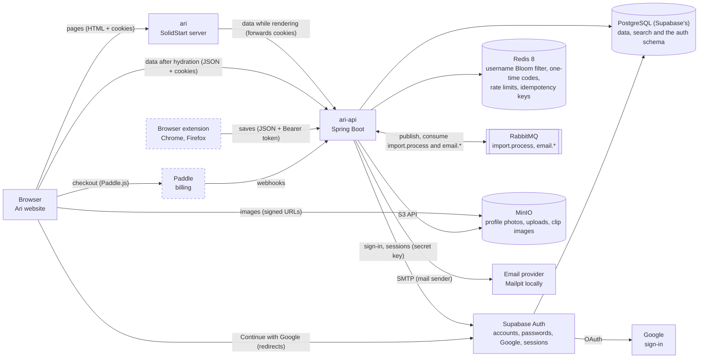
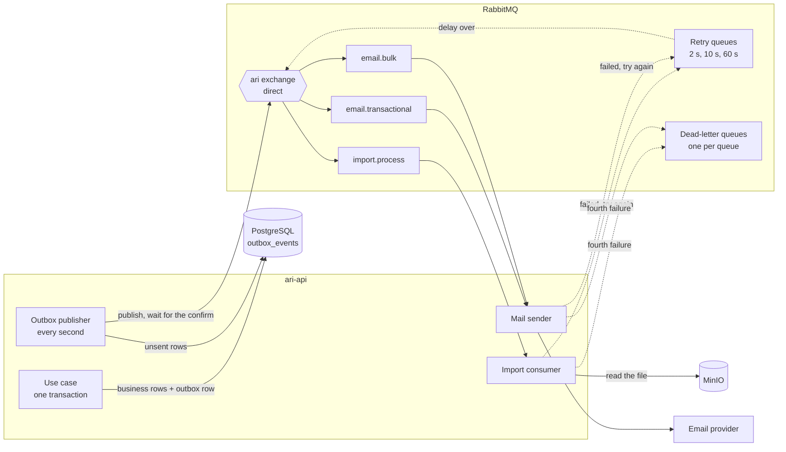

# ari-api architecture

Last updated 2026-11-02. The server side of Ari: how `ari-api` connects to its callers and
services, its sign-in rules and error codes, and how to build it. Read it together with
`.claude/skills/ari-api/SKILL.md`. If they ever disagree, ask before writing code.

| File | What it shows |
|---|---|
| `architecture.md` (this file) | How ari-api connects, sign-in rules, error codes, implementation guide |
| [`sequences.md`](sequences.md) | Step by step: sign-in and the username check, refresh, library page, saving, imports, extension, billing, email |
| [`database.md`](database.md) | Every table, column and relation, plus what lives in Redis and MinIO |

Feature numbers (F1, F8, F9…) match the GitHub issues on the "Ari" project board.

## 1. System overview

Dashed boxes are later features. Accounts, sessions and the account page live in PostgreSQL, Redis,
RabbitMQ, the mail sender and MinIO; the library endpoints get their tables when their features
are built.

Key decisions:

- `ari-api` is a JSON API with three callers: the `ari` server while it renders pages (it forwards
  the browser's cookies), the browser after hydration (cookies, with CORS allowing the web origin
  and credentials), and the extension (F13, `Authorization: Bearer`, with CORS allowing extension
  origins without credentials).
- **Supabase Auth** keeps the accounts' passwords, Google identities and sessions in the `auth`
  schema of the same PostgreSQL, and issues the tokens (JWTs signed with the project's asymmetric
  keys). Only `ari-api` calls it, with the project's secret key: the website and the extension never
  see Supabase, its keys or its client library; they keep using `ari-api`'s cookies and JSON
  tokens. A `users` row is the profile of one `auth.users` row, made by a database trigger when
  Supabase creates the user ([database.md](database.md#12-account-and-billing)).
- Only `ari-api` reads and writes the app's tables and receives Paddle webhooks. Supabase's Data API
  (PostgREST) gets no grants on them. Only the webhook changes a user's plan.
- **Redis 8** has the Bloom filter built in (`BF.*` commands, sent through Spring Data Redis's
  `RedisConnection.execute`, no extra client). A Bloom filter of taken usernames answers the live
  "is this username free?" check without the database in most cases; the database's unique key
  still decides ([sequences §1](sequences.md#1-register-or-sign-in-f1)). Redis also holds one-time
  codes, rate limits and idempotency keys, never data that only lives there.
- **RabbitMQ** runs everything slow in the background. `ari-api` never publishes inside a request:
  it writes an outbox row in the same transaction as the business change, and the outbox publisher
  sends it (section 1.1). Uploaded files are read by the import consumer inside `ari-api`
  ([sequences §5](sequences.md#5-pdf-or-word-import-f11)).
- **The mail sender** is a module of `ari-api` for now (`feature/mail`): it consumes the `email.*`
  queues, renders the Thymeleaf template for the message's type and language, and sends it over
  SMTP (Mailpit locally, any provider later). It reads no table; Redis tells it whether an event
  was already sent ([sequences §8](sequences.md#8-add-and-verify-an-email)). It talks to the rest
  of `ari-api` only through RabbitMQ, so it can move to its own app without changes.
- **MinIO** stores files through the S3 API (`common/client/ObjectStorage`, the AWS SDK), so any
  S3-compatible server can replace it by config: profile photos now, uploads until they are read
  and clipped images later. MinIO no longer publishes its own images, so compose and the tests run
  the pinned community fork `pgsty/minio`. The bucket is private and created at startup; `ari-api`
  hands the browser signed links valid for an hour, signed for `STORAGE_PUBLIC_ENDPOINT`, the
  address the browser reaches. The object keys are in
  [database.md](database.md#5-redis-and-minio).
- Local URLs: API `http://localhost:8080`, base path `/api/v1`, web origin `http://localhost:3000`.
  Cookies ignore the port, so the `ari` server receives the cookies `ari-api` sets on `localhost`.
  In production the two apps run on sibling subdomains and the cookies set `Domain` to the shared
  parent domain (F16).

### 1.1 Background jobs

- A consumer that fails rejects the message into the next retry queue (2 s, then 10 s, then 60 s,
  by message TTL); when the delay is over it goes back to its queue. The fourth failure goes to the
  dead-letter queue, and the user sees a failed import.
- Consumers are idempotent by event id: the import consumer through `processed_events`, the mail
  sender through a Redis key.

## 2. Configuration

Every value comes from an environment variable (locally from `.env`, see `.env.example`).

| Variable | Default | Meaning |
|---|---|---|
| `DB_URL`, `DB_USERNAME` | `jdbc:postgresql://127.0.0.1:54322/postgres`, `postgres` | Supabase's PostgreSQL; `supabase start` serves it on 54322. A hosted project: its session pooler |
| `DB_PASSWORD` | none (required) | `postgres` locally; the project's database password when hosted |
| `SUPABASE_URL` | `http://127.0.0.1:54321` | Where `ari-api` calls Supabase Auth; `supabase start` serves it |
| `SUPABASE_PUBLIC_URL` | blank (`SUPABASE_URL`) | Where browsers reach it (Google sign-in), and its tokens' issuer; only differs when `ari-api` runs in Docker |
| `SUPABASE_SECRET_KEY` | none (required) | The project's secret key (`sb_secret_...`): `supabase status` prints the local one |
| `SUPABASE_AUTH_EXTERNAL_GOOGLE_CLIENT_ID`, `..._SECRET` | none | Read by `supabase start` from `.env`, not by `ari-api`: the Google OAuth client |
| `APP_API_URL` | `http://localhost:8080` | `ari-api` as browsers reach it, for Google's way back |
| `RABBITMQ_HOST`, `RABBITMQ_PORT` | `localhost`, `5672` | RabbitMQ; `docker compose up -d rabbitmq` starts one |
| `RABBITMQ_USERNAME`, `RABBITMQ_PASSWORD` | `ari`, none | Also set the user of the compose `rabbitmq` service |
| `APP_COOKIE_SECURE` | `true` | `false` only for `http://localhost` |
| `APP_COOKIE_DOMAIN` | blank | Shared parent domain in production; blank keeps cookies on the API host |
| `APP_SEED_DEMO_DATA` | `false` | Adds `demo` / `demo1234`; local development and tests only |
| `REDIS_URL` | `redis://localhost:6379` | Redis; `docker compose up -d redis` starts one |
| `APP_WEB_URL` | `http://localhost:3000` | The website, for links in emails |
| `MAIL_HOST`, `MAIL_PORT` | `localhost`, `1025` | SMTP; Mailpit locally (`docker compose up -d mailpit`, inbox on http://localhost:8025) |
| `MAIL_USERNAME`, `MAIL_PASSWORD` | blank | The email provider's SMTP login. Locally a fake one (`ari-local` / `ari-local-only` in `.env`), which Mailpit accepts like any other. Production also needs STARTTLS (F16) |
| `MAIL_STARTTLS`, `MAIL_SSL` | `false`, `false` | Encryption a real provider needs: STARTTLS on port 587 (Gmail, Brevo) or SSL on 465. Examples in `.env.example` |
| `MAIL_DOCKER_HOST` | `mailpit` | The SMTP host the API uses inside docker compose; set it to the provider's host to send real emails from there |
| `APP_MAIL_FROM` | `Ari <no-reply@ari.test>` | The sender of every email; `.test` is reserved for testing, so production sets a real address |
| `STORAGE_ENDPOINT` | `http://localhost:9000` | Where `ari-api` reaches MinIO; `http://minio:9000` inside compose |
| `STORAGE_PUBLIC_ENDPOINT` | `http://localhost:9000` | Where the browser reaches MinIO; photo links are signed for it |
| `STORAGE_ACCESS_KEY`, `STORAGE_SECRET_KEY` | `ari-local`, none | Also the compose `minio` service's root user; local-only values in `.env` |
| `STORAGE_BUCKET`, `STORAGE_REGION` | `ari`, `us-east-1` | The one bucket, created at startup; MinIO ignores the region, S3 signatures need one |

## 3. Sign-in rules

| Rule | Value |
|---|---|
| Accounts | Supabase Auth users. Password users sign in with their username: `ari-api` finds the user's Supabase sign-in email (their verified email, or `<id>@no-email.ari.invalid` until they have one) and signs in with it. Google users come through Supabase's Google provider ([sequences §2.1](sequences.md#21-continue-with-google-f9)) |
| Access cookie | `ari_access`: Supabase's JWT (ES256, 15 minutes with `jwt_expiry = 900`), claims `iss` (`<SUPABASE_PUBLIC_URL>/auth/v1`), `sub` (user id), `aud` (`authenticated`), `session_id`. Cookie `Max-Age` is the token's `expires_in` minus a minute, so a cookie the browser still sends never holds an expired JWT |
| Token checks | Signature against the project's JWKS (`/auth/v1/.well-known/jwks.json`, ES256 or RS256, cached), expiry with the injected `Clock`, the issuer, and `aud` = `authenticated`, so the project's API keys (JWTs too) never pass |
| Refresh cookie | `ari_refresh`: Supabase's refresh token, `Max-Age` 30 days, replaced on every refresh |
| Freshness cookie | `ari_access_fresh=1`: no token, gone a minute before `ari_access`. Not `HttpOnly`: the website reads it and refreshes before an upload instead of sending the file to get a 401. Set and cleared with the other two |
| Google verifier | `ari_google`: the PKCE verifier of a Google sign-in, `HttpOnly`, `Path=/api/v1/auth/google`, 10 minutes, cleared on the way back |
| Cookie flags | All: `SameSite=Lax`, `Secure` outside local http, `Domain` = shared parent domain in production. `Path=/` (but `ari_google`) lets the `ari` server send `ari_refresh` and refresh while rendering ([sequences §2](sequences.md#2-token-refresh-f1)) |
| Reuse detection | Supabase's: a replaced refresh token works for 10 more seconds (`refresh_token_reuse_interval`), for a server render and a browser call refreshing at once; reused later, it ends its session |
| Refresh fails | 401 `UNAUTHORIZED`, and the cookies are cleared; only the API can delete httpOnly cookies |
| Passwords | 8 characters to 72 bytes (bcrypt's limit), kept by Supabase (bcrypt). Supabase's own rules may refuse one too: 400 `WEAK_PASSWORD` |
| Login answers | `INVALID_CREDENTIALS` for every failure; an unknown username is still sent to Supabase (as an address nobody has), so it takes a round trip like a wrong password. Supabase's rate limit is 429 `RATE_LIMITED` |
| Rate limits | Supabase limits sign-ins and refreshes per address. Every call carries the browser's address in `Sb-Forwarded-For`, which a hosted project must allow (Authentication, Rate Limits, "IP address forwarding"); otherwise all users share `ari-api`'s address and its limits |
| Stored secrets | None of the tokens: Supabase keeps its refresh tokens; `ari-api` only holds the secret key |
| Logout | `POST /api/v1/auth/logout` signs the session out at Supabase (with `ari_access`, or a refresh first when it is gone) and clears the cookies (always 204) |
| Stale cookies | The sign-in endpoints (`/api/v1/auth/**`) ignore `ari_access`, so an old cookie never blocks signing in |
| Extension | Its own Supabase session; the tokens travel in JSON bodies and `Authorization: Bearer`, never in cookies. It signs in with a code the signed-in website gets from `POST /api/v1/me/extension-code`, or that `POST /api/v1/auth/extension/code` gives for another account's username and password without setting cookies (60 seconds, single use, only its SHA-256 in Redis), swapped at `POST /api/v1/auth/extension/token` for a session `ari-api` starts through Supabase's admin API (a magic-link token that is never emailed); then `/auth/extension/refresh` and `/auth/extension/logout` take the refresh token in the body ([sequences §6](sequences.md#6-save-from-the-extension-f13)) |
| Extension CORS | Firefox sends `Origin: moz-extension://<uuid>`, a uuid of each install, so `moz-extension://*` and `chrome-extension://*` are allowed by pattern, without credentials |

## 4. Error codes

Every error is an RFC 9457 Problem Detail with a stable `code`.

| Code | Status | When |
|---|---|---|
| `VALIDATION_FAILED` | 400 | Bad body, query or upload (file type or size) |
| `UNAUTHORIZED` | 401 | Missing, expired or invalid token, sign-in code or webhook signature |
| `INVALID_CREDENTIALS` | 401 | Wrong username or password |
| `WEAK_PASSWORD` | 400 | A password that passed ari-api's rules but not Supabase Auth's (stricter settings on a hosted project) |
| `INVALID_CODE` | 401 | An email's verify link, or the extension's sign-in code, is unknown, expired or used; or a newer address is waiting for its link; or a password's reset link is unknown (an expired or used one is 410) |
| `NOT_FOUND` | 404 | The item does not exist or belongs to another user |
| `INVALID_SAVE` | 400 | A save breaks the rules of its kind: a highlight without a color, a clip with one or without a clip type, a table clip without Markdown, an image clip without its image, an `IMPORT` posted directly; or a color set on a clip |
| `INVALID_IMAGE` | 400 | A clip's image isn't a JPEG, PNG or WebP by its bytes |
| `INVALID_URL` | 400 | A source's address isn't an http or https address of at most 2048 characters |
| `INVALID_CURSOR` | 400 | A list cursor the API did not make, or one made for the list's other order |
| `ACCOUNT_NOT_FOUND` | 404 | No account has the username or verified email a reset link was asked for |
| `NO_EMAIL` | 409 | The account has no email to send a reset link to |
| `EMAIL_NOT_CONFIRMED` | 409 | The email still waits for its verify link; a pending email never gets a reset link |
| `CODE_EXPIRED` | 410 | A reset link older than its 30 minutes |
| `CODE_USED` | 410 | A reset link that changed a password already |
| `INVALID_NOTE` | 400 | A note's block holds what its kind doesn't: a `TEXT` block without text or with a save, a `QUOTE` block without a save or with text |
| `USERNAME_TAKEN` | 409 | Register, or change the profile to, a username that is already used, in any case |
| `INVALID_PHOTO` | 400 | A profile photo that isn't a JPEG, PNG or WebP image by its bytes |
| `FILE_TOO_LARGE` | 413 | An upload over its limit: 2 MB for a profile photo or a clip's image, 50 MB (the whole upload space) for an imported file (the servlet's multipart limit; the 2 MB ones are checked in code) |
| `UNSUPPORTED_FILE` | 400 | An imported file that isn't a PDF or a Word DOCX by its bytes |
| `NO_SPACE_LEFT` | 400 | An imported file that doesn't fit in what is left of the upload space (50 MB for everyone, in files of any size) |
| `INVALID_IMPORT_STATE` | 409 | An import action its status doesn't allow: a review before the file is read, Retry of a file that didn't fail, Discard after the review, Dismiss of one still in use |
| `EMAIL_TAKEN` | 409 | A verify link is opened for an address another account verified first, or a Google account signs in with |
| `RATE_LIMITED` | 429 | Too many requests in a minute (Redis counters), e.g. the username check, or over the limits of email links and reset requests; or Supabase Auth's sign-in limits |

## 5. How it is built

Work one feature at a time, and give a plan before writing code. `feature/account` (F1) is the
first real module; copy its patterns.

**Persistence (the pattern for every feature)**

- Liquibase creates the tables at startup from `resources/db/changelog/` (files listed in
  [database.md](database.md#4-changesets)). Never edit an applied file; add the next numbered one.
- A domain port (`UserRepository`) gets a MyBatis adapter in `infrastructure/`: a `@Mapper`
  interface that extends the port (`UserMyBatisRepository`) plus its SQL in
  `resources/persistence/UserMyBatisRepository.xml`. Rows map straight into the domain records by
  constructor argument name (`pending_email` → `pendingEmail`).
- `common/handlers` holds the type handlers: `Instant` ↔ `timestamptz` in UTC, `UUID` ↔ `uuid`.
- Uniqueness is the database's job: inserts use `ON CONFLICT DO NOTHING` and return `false` when a
  unique key already exists.
- Services return `Optional` or `boolean`; facades turn "empty" into feature exceptions
  (`application/exception/`). `@Transactional` goes on facade use cases that write the app's
  tables; sign-in writes none (Supabase keeps the sessions, and its trigger makes the profile).

**F1 Sign in**

- `config/SecurityConfig`, API chain: stateless, CSRF off (`SameSite=Lax` cookies plus CORS), CORS
  with credentials for `APP_CORS_ALLOWED_ORIGINS` and without for extension origins
  (`config/CorsConfig`). Public: `/api/v1/auth/**`, `/actuator/health`,
  Swagger and `/error`. Everything else needs a valid JWT; a missing or bad one gets a 401 Problem
  Detail from `ProblemDetailsAuthenticationEntryPoint`.
- JWTs: a `NimbusJwtDecoder` on Supabase's JWKS, with `SecurityConfig.tokenValidator` (expiry with
  the injected `Clock`, issuer, audience). `CookieBearerTokenResolver` reads `ari_access`, then the
  `Authorization` header, and nothing on `/api/v1/auth/**`. `ari-api` signs no token.
- `domain/port/IdentityProvider` is Supabase Auth, as the account feature needs it: create a user,
  sign in, refresh, sign out, a session without a password (the extension), Google's PKCE code,
  and the sign-in email and password. `infrastructure/SupabaseIdentityProvider` calls GoTrue's REST
  API with a `RestClient` and the secret key; nothing else knows Supabase.
- `TokenService` signs in by username, rotates and ends sessions, issues the extension's sign-in
  codes (`ExtensionCodeRedisRepository`) and runs Google sign-in; `AccountControllerImpl` turns the
  website's tokens into cookies through `AuthCookies` and sends the extension's as JSON.
- `DemoUserSeeder` adds the demo user through Supabase when `APP_SEED_DEMO_DATA=true`, so
  production never has one.

### Tests that prove it works

`./gradlew check` runs them against Supabase's PostgreSQL image (Testcontainers; Docker must be
running), so the `auth` schema, the profile trigger and the foreign key are real. Supabase Auth is
`FakeSupabaseAuth` (test `support/`): users and sessions in memory, tokens signed with its own key,
which the tests' decoder trusts, and every user inserted into `auth.users` so the trigger runs:

- `AccountControllerTest`: register and login set both cookies with their flags; a taken username in
  any case is 409; bad input and passwords over 72 bytes are 400; `/me` works with the cookie or a
  Bearer header and is 401 without one or after 15 minutes; refresh rotates and a replaced token
  stops working; logout (with either cookie) clears the cookies and ends the session; a stale cookie
  doesn't block login; the CORS preflight allows credentials.
- `GoogleSignInTest` (F9): the start goes to Supabase's `/authorize` with a PKCE challenge and sets
  `ari_google`; a new Google user gets an account with their email and name, goes to `/welcome`, and
  `PUT /me` confirms the username; two users with the same email name get different usernames;
  another browser's verifier or a cancelled sign-in goes to `/login?error=google`.
- `ExtensionSignInTest` (F13): the website's code signs the extension in once and sets no cookies;
  another account's password gives a code without touching the website's cookies, a wrong one 401
  `INVALID_CREDENTIALS`; a code needs a signed-in website; the extension refreshes its own tokens;
  extension logout leaves the website signed in;
  CORS lets `moz-extension://` origins in without credentials and keeps other origins out.
- `AriApiApplicationTests`: Liquibase creates the tables, a profile needs its Supabase user and
  goes with it, the Data API roles have no grants and every table has row-level security, health is
  UP. `ArchitectureTest`: the layer rules from SKILL.md.

## 6. Deploying Supabase

`.github/workflows/deploy.yml` sets up the hosted Supabase project (`my-ari`) after `ci` passes on
`main`, or when run by hand. Hosting `ari-api` and the website comes later and joins the same
workflow.

1. **Database migrations:** `./gradlew migrate` runs Liquibase's command line on the app's own
   classpath (the same Liquibase and changelog as at startup, so the API later finds every
   changeset applied) against the project's session pooler.
2. **Auth settings:** `supabase config push` sends `supabase/config.toml` with its
   `[remotes.production]` block: the Google provider, the site address and the Google callback,
   15-minute tokens, the password rules. `supabase config diff --project-ref <ref>` shows what it
   would change, without changing anything.

The `production` environment in the repository's settings (Settings, Environments) holds:

| Name | Kind | Value |
|---|---|---|
| `SUPABASE_PROJECT_REF` | variable | The project's ref, also `[remotes.production].project_id` in `supabase/config.toml` |
| `ARI_WEB_URL` | variable | The website, e.g. `https://ari.example`: Supabase's site address |
| `ARI_API_URL` | variable | `ari-api`, e.g. `https://api.ari.example`: Google returns to its `/api/v1/auth/google/callback` |
| `SUPABASE_ACCESS_TOKEN` | secret | A personal access token (Account, Access Tokens) for the CLI |
| `SUPABASE_DB_URL` | secret | The session pooler as JDBC, from Connect, Session pooler: `jdbc:postgresql://aws-0-eu-west-1.pooler.supabase.com:5432/postgres?sslmode=require`. GitHub's runners have no IPv6, which the direct address needs |
| `SUPABASE_DB_USERNAME` | secret | The pooler's user: `postgres.<project ref>` |
| `SUPABASE_DB_PASSWORD` | secret | The database password |
| `SUPABASE_AUTH_EXTERNAL_GOOGLE_CLIENT_ID`, `SUPABASE_AUTH_EXTERNAL_GOOGLE_SECRET` | secrets | The production Google OAuth client, whose authorized redirect URI is `https://<project ref>.supabase.co/auth/v1/callback` |

Once, by hand, in the dashboard:

- **Rate limits:** Authentication, Rate Limits, turn on IP address forwarding, so the
  `Sb-Forwarded-For` address `ari-api` sends counts instead of its own.
- **Signing keys:** the project signs with ES256 keys already (JWT Keys); `ari-api` checks tokens
  against its JWKS, so nothing to copy.
- **Google OAuth client:** the consent screen's app name is the one Google shows ("Ari").

The workflow never changes what `config.toml` doesn't declare, and `email` confirmations stay on:
a sign-up through Supabase's public API with someone else's address must never count as theirs,
since a Google sign-in with that address would join it.
