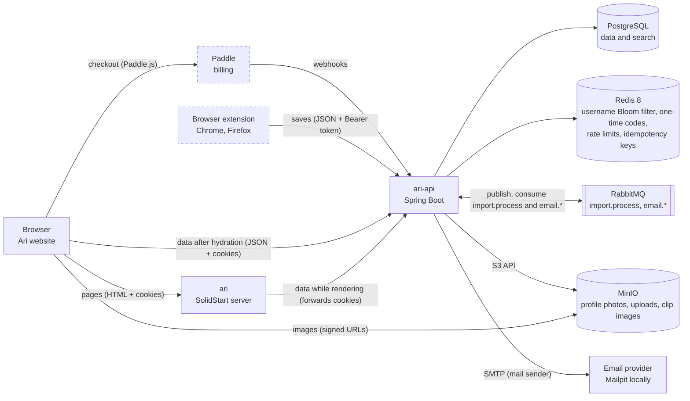
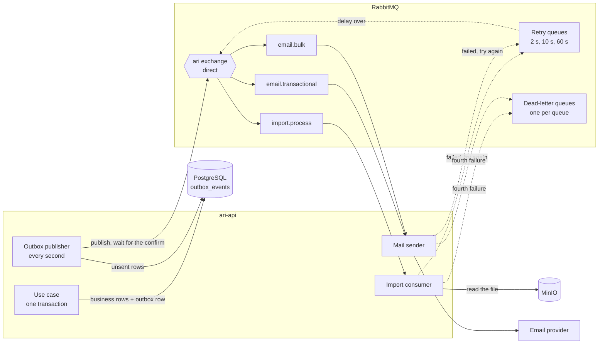

# ari-api architecture

Last updated 2026-10-12. The server side of Ari: how `ari-api` connects to its callers and
services, its sign-in rules and error codes, and how to build it. Read it together with
`.claude/skills/ari-api/SKILL.md`. If they ever disagree, ask before writing code.

| File | What it shows |
|---|---|
| `architecture.md` (this file) | How ari-api connects, sign-in rules, error codes, implementation guide |
| [`sequences.md`](sequences.md) | Step by step: sign-in and the username check, refresh, library page, saving, imports, extension, billing, email |
| [`database.md`](database.md) | Every table, column and relation, plus what lives in Redis and MinIO |

Feature numbers (F1, F8, F9…) match the GitHub issues on the "Ari" project board.

## 1. System overview

Dashed boxes are later features. Accounts, sessions and the account page live in PostgreSQL, Redis,
RabbitMQ, the mail sender and MinIO; the library endpoints get their tables when their features
are built.

Key decisions:

- `ari-api` is a JSON API with three callers: the `ari` server while it renders pages (it forwards
  the browser's cookies), the browser after hydration (cookies, with CORS allowing the web origin
  and credentials), and the extension (F13, `Authorization: Bearer`, with CORS allowing extension
  origins without credentials).
- Only `ari-api` talks to PostgreSQL and receives Paddle webhooks. Only the webhook changes a user's
  plan.
- **Redis 8** has the Bloom filter built in (`BF.*` commands, sent through Spring Data Redis's
  `RedisConnection.execute`, no extra client). A Bloom filter of taken usernames answers the live
  "is this username free?" check without the database in most cases; the database's unique key
  still decides ([sequences §1](sequences.md#1-register-or-sign-in-f1)). Redis also holds one-time
  codes, rate limits and idempotency keys, never data that only lives there.
- **RabbitMQ** runs everything slow in the background. `ari-api` never publishes inside a request:
  it writes an outbox row in the same transaction as the business change, and the outbox publisher
  sends it (section 1.1). Uploaded files are read by the import consumer inside `ari-api`
  ([sequences §5](sequences.md#5-pdf-or-word-import-f11)).
- **The mail sender** is a module of `ari-api` for now (`feature/mail`): it consumes the `email.*`
  queues, renders the Thymeleaf template for the message's type and language, and sends it over
  SMTP (Mailpit locally, any provider later). It reads no table; Redis tells it whether an event
  was already sent ([sequences §8](sequences.md#8-add-and-verify-an-email)). It talks to the rest
  of `ari-api` only through RabbitMQ, so it can move to its own app without changes.
- **MinIO** stores files through the S3 API (`common/client/ObjectStorage`, the AWS SDK), so any
  S3-compatible server can replace it by config: profile photos now, uploads until they are read
  and clipped images later. MinIO no longer publishes its own images, so compose and the tests run
  the pinned community fork `pgsty/minio`. The bucket is private and created at startup; `ari-api`
  hands the browser signed links valid for an hour, signed for `STORAGE_PUBLIC_ENDPOINT`, the
  address the browser reaches. The object keys are in
  [database.md](database.md#5-redis-and-minio).
- Local URLs: API `http://localhost:8080`, base path `/api/v1`, web origin `http://localhost:3000`.
  Cookies ignore the port, so the `ari` server receives the cookies `ari-api` sets on `localhost`.
  In production the two apps run on sibling subdomains and the cookies set `Domain` to the shared
  parent domain (F16).

### 1.1 Background jobs

- A consumer that fails rejects the message into the next retry queue (2 s, then 10 s, then 60 s,
  by message TTL); when the delay is over it goes back to its queue. The fourth failure goes to the
  dead-letter queue, and the user sees a failed import.
- Consumers are idempotent by event id: the import consumer through `processed_events`, the mail
  sender through a Redis key.

## 2. Configuration

Every value comes from an environment variable (locally from `.env`, see `.env.example`).

| Variable | Default | Meaning |
|---|---|---|
| `DB_URL`, `DB_USERNAME` | `jdbc:postgresql://localhost:5432/ari`, `ari` | PostgreSQL; `docker compose up -d postgres` starts one |
| `DB_PASSWORD` | none (required) | Also sets the password of the compose `postgres` service |
| `RABBITMQ_HOST`, `RABBITMQ_PORT` | `localhost`, `5672` | RabbitMQ; `docker compose up -d rabbitmq` starts one |
| `RABBITMQ_USERNAME`, `RABBITMQ_PASSWORD` | `ari`, none | Also set the user of the compose `rabbitmq` service |
| `APP_JWT_SECRET` | none (required) | HS256 key for access tokens, at least 32 characters (`openssl rand -base64 48`) |
| `APP_COOKIE_SECURE` | `true` | `false` only for `http://localhost` |
| `APP_COOKIE_DOMAIN` | blank | Shared parent domain in production; blank keeps cookies on the API host |
| `APP_SEED_DEMO_DATA` | `false` | Adds `demo` / `demo1234`; local development and tests only |
| `REDIS_URL` | `redis://localhost:6379` | Redis; `docker compose up -d redis` starts one |
| `APP_WEB_URL` | `http://localhost:3000` | The website, for links in emails |
| `MAIL_HOST`, `MAIL_PORT` | `localhost`, `1025` | SMTP; Mailpit locally (`docker compose up -d mailpit`, inbox on http://localhost:8025) |
| `MAIL_USERNAME`, `MAIL_PASSWORD` | blank | The email provider's SMTP login. Locally a fake one (`ari-local` / `ari-local-only` in `.env`), which Mailpit accepts like any other. Production also needs STARTTLS (F16) |
| `MAIL_STARTTLS`, `MAIL_SSL` | `false`, `false` | Encryption a real provider needs: STARTTLS on port 587 (Gmail, Brevo) or SSL on 465. Examples in `.env.example` |
| `MAIL_DOCKER_HOST` | `mailpit` | The SMTP host the API uses inside docker compose; set it to the provider's host to send real emails from there |
| `APP_MAIL_FROM` | `Ari <no-reply@ari.test>` | The sender of every email; `.test` is reserved for testing, so production sets a real address |
| `STORAGE_ENDPOINT` | `http://localhost:9000` | Where `ari-api` reaches MinIO; `http://minio:9000` inside compose |
| `STORAGE_PUBLIC_ENDPOINT` | `http://localhost:9000` | Where the browser reaches MinIO; photo links are signed for it |
| `STORAGE_ACCESS_KEY`, `STORAGE_SECRET_KEY` | `ari-local`, none | Also the compose `minio` service's root user; local-only values in `.env` |
| `STORAGE_BUCKET`, `STORAGE_REGION` | `ari`, `us-east-1` | The one bucket, created at startup; MinIO ignores the region, S3 signatures need one |

## 3. Sign-in rules

| Rule | Value |
|---|---|
| Access cookie | `ari_access`: JWT, HS256, 15 minutes, claims `iss` (`ari-api`), `sub` (user id), `plan`. Cookie `Max-Age` 14 minutes, so a cookie the browser still sends never holds an expired JWT |
| Refresh cookie | `ari_refresh`: 32 random bytes, 30 days from the last refresh, replaced on every refresh |
| Cookie flags | Both: `Path=/`, `HttpOnly`, `SameSite=Lax`, `Secure` outside local http, `Domain` = shared parent domain in production. `Path=/` lets the `ari` server send `ari_refresh` and refresh while rendering ([sequences §2](sequences.md#2-token-refresh-f1)) |
| Reuse detection | A replaced refresh token used again within 10 seconds still gets a new pair, while its session has an active token (a server render and a browser call refreshing at once). Otherwise using it revokes its whole session. Logout stays final |
| Refresh fails | 401 `UNAUTHORIZED`, and both cookies are cleared; only the API can delete httpOnly cookies |
| Passwords | 8 characters to 72 bytes (bcrypt's limit), stored as bcrypt hashes |
| Login answers | `INVALID_CREDENTIALS` for every failure, and unknown usernames run a bcrypt check too, so neither the answer nor its timing reveals which usernames exist |
| Stored secrets | Only the SHA-256 hash of a refresh token |
| Logout | `POST /api/v1/auth/logout` revokes the session and clears both cookies (always 204) |
| Stale cookies | The sign-in endpoints (`/api/v1/auth/**`) ignore `ari_access`, so an old cookie never blocks signing in |
| Extension | Same token rules, but the tokens travel in JSON bodies and `Authorization: Bearer`, never in cookies. It signs in with a code the signed-in website gets from `POST /api/v1/me/extension-code`, or that `POST /api/v1/auth/extension/code` gives for another account's username and password without setting cookies (60 seconds, single use, only its SHA-256 in Redis), swapped at `POST /api/v1/auth/extension/token`; then `/auth/extension/refresh` and `/auth/extension/logout` take the refresh token in the body ([sequences §6](sequences.md#6-save-from-the-extension-f13)). Its refresh tokens are stored with `client = EXTENSION`, and each refresh endpoint takes only its own client's tokens |
| Extension CORS | Firefox sends `Origin: moz-extension://<uuid>`, a uuid of each install, so `moz-extension://*` and `chrome-extension://*` are allowed by pattern, without credentials |

## 4. Error codes

Every error is an RFC 9457 Problem Detail with a stable `code`.

| Code | Status | When |
|---|---|---|
| `VALIDATION_FAILED` | 400 | Bad body, query or upload (file type or size) |
| `UNAUTHORIZED` | 401 | Missing, expired or invalid token, sign-in code or webhook signature |
| `INVALID_CREDENTIALS` | 401 | Wrong username or password |
| `INVALID_CODE` | 401 | An email's verify link, or the extension's sign-in code, is unknown, expired or used; or a newer address is waiting for its link; or a password's reset link is unknown (an expired or used one is 410) |
| `NOT_FOUND` | 404 | The item does not exist or belongs to another user |
| `INVALID_SAVE` | 400 | A save breaks the rules of its kind: a highlight without a color, a clip with one or without a clip type, a table clip without Markdown, an image clip without its image, an `IMPORT` posted directly; or a color set on a clip |
| `INVALID_IMAGE` | 400 | A clip's image isn't a JPEG, PNG or WebP by its bytes, or is over 2 MB |
| `INVALID_URL` | 400 | A source's address isn't an http or https address of at most 2048 characters |
| `INVALID_CURSOR` | 400 | A list cursor the API did not make, or one made for the list's other order |
| `ACCOUNT_NOT_FOUND` | 404 | No account has the username or verified email a reset link was asked for |
| `NO_EMAIL` | 409 | The account has no email to send a reset link to |
| `EMAIL_NOT_CONFIRMED` | 409 | The email still waits for its verify link; a pending email never gets a reset link |
| `CODE_EXPIRED` | 410 | A reset link older than its 30 minutes |
| `CODE_USED` | 410 | A reset link that changed a password already |
| `INVALID_NOTE` | 400 | A note's block holds what its kind doesn't: a `TEXT` block without text or with a save, a `QUOTE` block without a save or with text |
| `USERNAME_TAKEN` | 409 | Register, or change the profile to, a username that is already used, in any case |
| `INVALID_PHOTO` | 400 | A profile photo that isn't a JPEG, PNG or WebP image by its bytes, or is over 2 MB |
| `FILE_TOO_LARGE` | 413 | An upload over the server's limit (2 MB for a profile photo or a clip's image) |
| `EMAIL_TAKEN` | 409 | A verify link is opened for an address another account verified first |
| `RATE_LIMITED` | 429 | Too many requests in a minute (Redis counters), e.g. the username check, or over the limits of email links and reset requests |

## 5. How it is built

Work one feature at a time, and give a plan before writing code. `feature/account` (F1) is the
first real module; copy its patterns.

**Persistence (the pattern for every feature)**

- Liquibase creates the tables at startup from `resources/db/changelog/` (files listed in
  [database.md](database.md#4-changesets)). Never edit an applied file; add the next numbered one.
- A domain port (`UserRepository`) gets a MyBatis adapter in `infrastructure/`: a `@Mapper`
  interface that extends the port (`UserMyBatisRepository`) plus its SQL in
  `resources/persistence/UserMyBatisRepository.xml`. Rows map straight into the domain records by
  constructor argument name (`password_hash` → `passwordHash`).
- `common/handlers` holds the type handlers: `Instant` ↔ `timestamptz` in UTC, `UUID` ↔ `uuid`.
- Uniqueness is the database's job: inserts use `ON CONFLICT DO NOTHING` and return `false` when a
  unique key already exists; `revoke` matches only `revoked_at IS NULL`, so two parallel refreshes
  of one token can't both win.
- Services return `Optional` or `boolean`; facades turn "empty" into feature exceptions
  (`application/exception/`). `@Transactional` goes on facade use cases, except where a failed
  request must keep its writes: refresh and logout commit inside `TokenService`, so reuse detection
  stays in force after its 401.

**F1 Sign in**

- `config/SecurityConfig`, API chain: stateless, CSRF off (`SameSite=Lax` cookies plus CORS), CORS
  with credentials for `APP_CORS_ALLOWED_ORIGINS` and without for extension origins
  (`config/CorsConfig`). Public: `/api/v1/auth/**`, `/actuator/health`,
  Swagger and `/error`. Everything else needs a valid JWT; a missing or bad one gets a 401 Problem
  Detail from `ProblemDetailsAuthenticationEntryPoint`.
- JWTs: `NimbusJwtEncoder` / `NimbusJwtDecoder`, HS256 with `APP_JWT_SECRET`, issuer `ari-api`.
  The decoder checks expiry with the injected `Clock`. `CookieBearerTokenResolver` reads
  `ari_access`, then the `Authorization` header, and nothing on `/api/v1/auth/**`.
- `TokenService` creates and rotates tokens, and the extension's sign-in codes
  (`ExtensionCodeRedisRepository`); `AccountControllerImpl` turns the website's tokens into cookies
  through `AuthCookies` and sends the extension's as JSON.
- `DemoUserSeeder` adds the demo user when `APP_SEED_DEMO_DATA=true`, so production never has one.

### Tests that prove it works

`./gradlew check` runs them against a PostgreSQL 18 container (Testcontainers; Docker must be
running):

- `AccountControllerTest`: register and login set both cookies with their flags; a taken username in
  any case is 409; bad input and passwords over 72 bytes are 400; `/me` works with the cookie or a
  Bearer header and is 401 without one or after 15 minutes; refresh rotates; a replaced token works
  for 10 seconds and then revokes its session; logout clears the cookies and ends the session; a
  stale cookie doesn't block login; the CORS preflight allows credentials.
- `ExtensionSignInTest` (F13): the website's code signs the extension in once and sets no cookies;
  another account's password gives a code without touching the website's cookies, a wrong one 401
  `INVALID_CREDENTIALS`; a code needs a signed-in website; the extension refreshes its own tokens with reuse detection;
  website and extension refresh tokens don't mix; extension logout leaves the website signed in;
  CORS lets `moz-extension://` origins in without credentials and keeps other origins out.
- `AriApiApplicationTests`: Liquibase creates the tables, health is UP. `ArchitectureTest`: the layer rules from SKILL.md.
