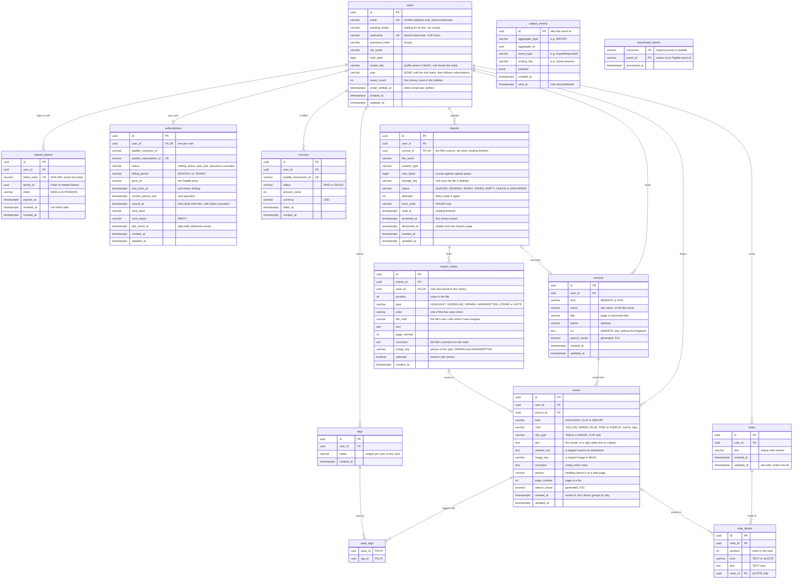

# Ari database: every table in one diagram

Last updated 2026-10-12. The same tables as [database.md](database.md), in one Mermaid block to
copy at once (for example into https://mermaid.live). Column rules, indexes and changesets are in
database.md; keep the two files in step.

