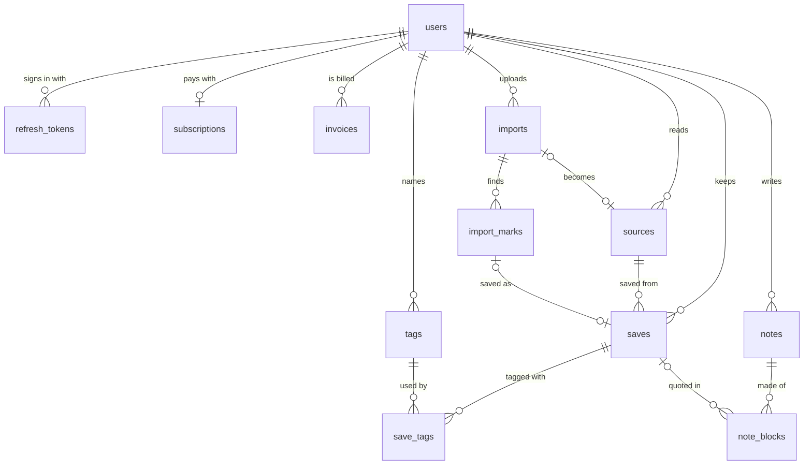
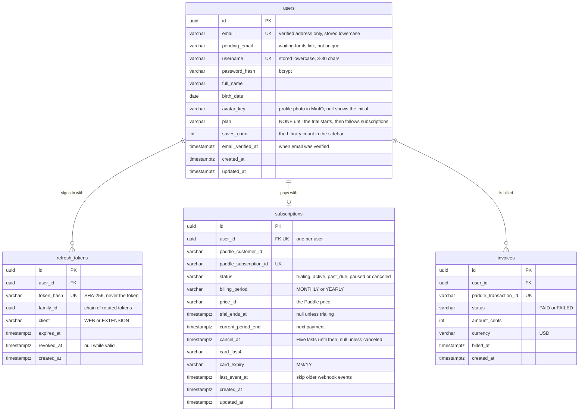
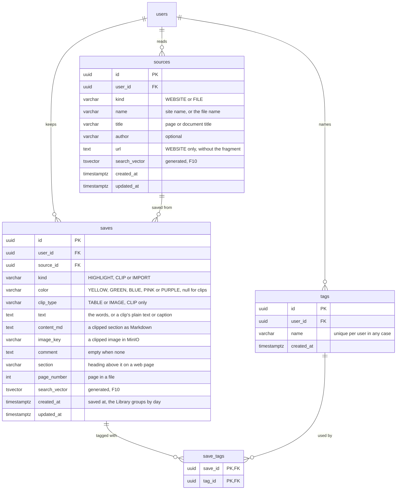
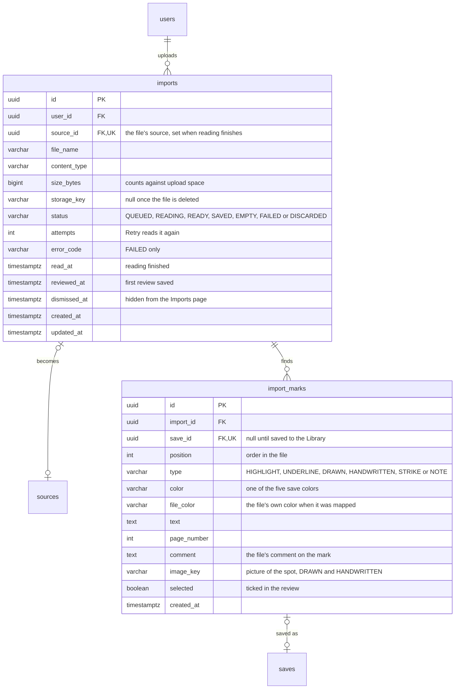
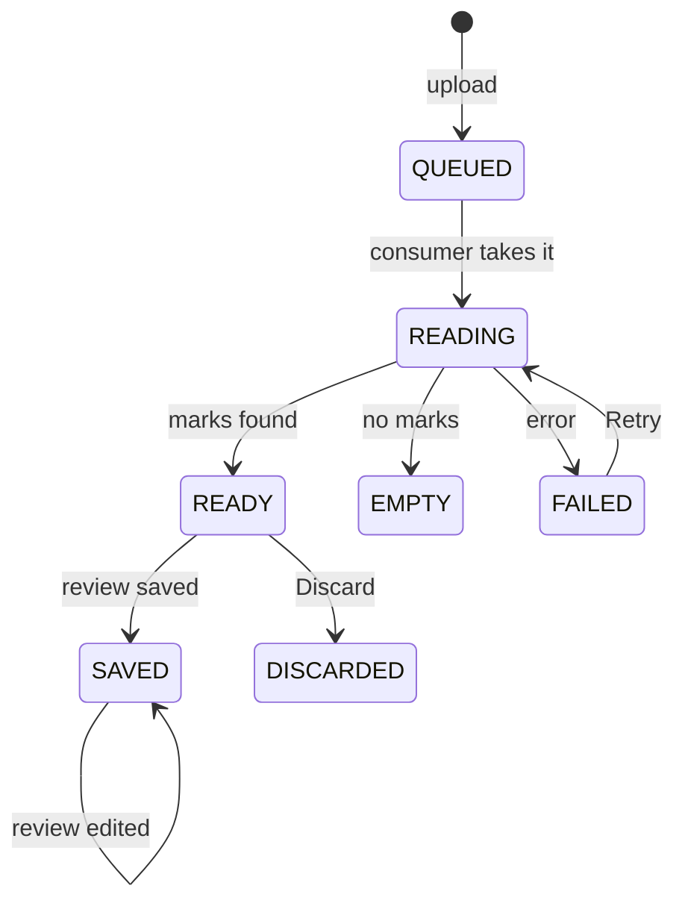
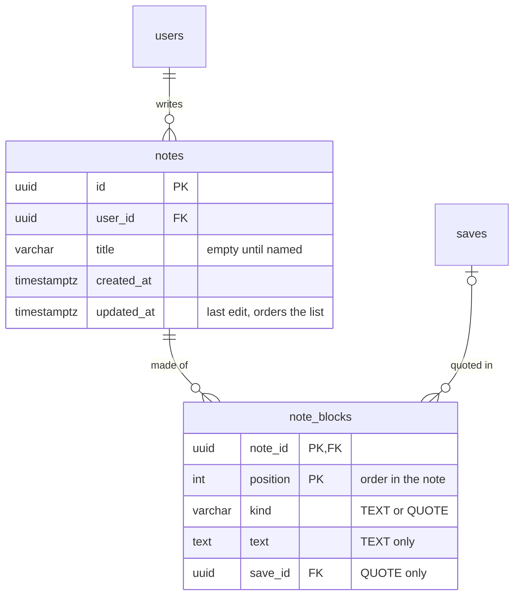
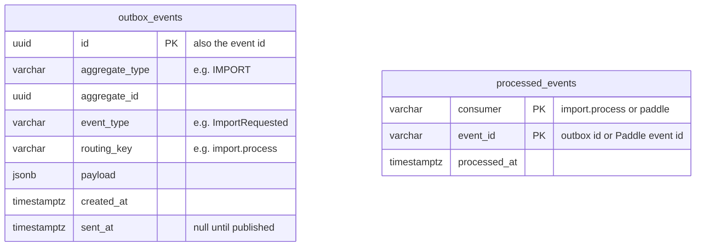
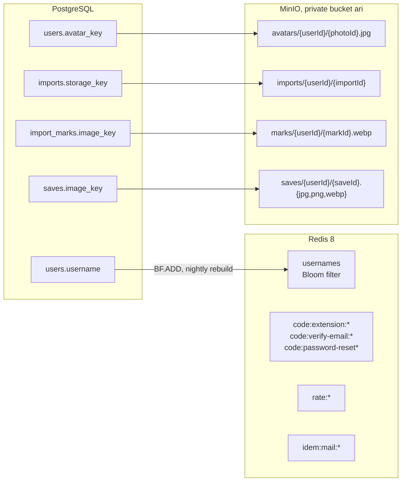

# Ari database

Last updated 2026-10-14. PostgreSQL 18 (`docker compose up -d postgres`), migrations with Liquibase,
queries with MyBatis. The tables follow what the ari frontend shows: the Library, Sources, Imports,
Notes and Settings pages; Imports and Settings run on sample data in the page until their tables
exist. The
sign-in tables (`users`, `refresh_tokens`) exist since F1; every other table arrives with the
feature that first uses it. The flows that use these tables are in [sequences.md](sequences.md),
and every table with all its columns is in one diagram in [database-erd.md](database-erd.md).

## 1. Tables and relations

### 1.1 Overview

`outbox_events` and `processed_events` (section 1.6) stand alone: they point at other rows through
their payload and ids, not through foreign keys.

Where each screen of the frontend gets its data:

| Screen (ari) | Tables |
|---|---|
| Register, log in, the user in the sidebar | `users`, `refresh_tokens`; the username check asks the Redis Bloom filter first |
| Settings › Account: photo, profile, email | `users` (`avatar_key`, `email`, `pending_email`); the email's verify code lives in Redis |
| Settings › Plan and billing | `subscriptions`, `invoices`; upload space is summed from `imports` |
| Library: list, grid, type tabs, tag / color / source filters, reading view | `saves`, `sources`, `tags`, `save_tags` |
| Sources and a source's page | `sources`, with counts, colors and "quoted in a note" computed from `saves` and `note_blocks` |
| Imports and the review | `imports`, `import_marks`, which become `saves` of a file's `sources` row |
| Notes | `notes`, `note_blocks`, whose quotes point at `saves` |
| Search palette (⌘K) | `saves.search_vector`, `sources.search_vector` (F10) |
| Settings › Export | Reads `saves`, `sources`, `tags` and `notes` and streams the file; no table |
| Settings › Shortcuts and Connected apps, the language | No table: shortcuts are fixed, Notion and Google Docs are "coming soon", the language is the `ari_lang` cookie |

### 1.2 Account and billing

- The Plan and billing section's states come from `subscriptions` (section 3).
- `invoices` holds one row per Paddle transaction, for the invoice list and the "payment didn't go
  through" notice. The invoice PDF is fetched from Paddle when asked for, not stored.

### 1.3 Library: sources, saves and tags

- **Kinds:** `HIGHLIGHT` is marked text from a web page, `CLIP` a whole page section (a table as
  Markdown, or an image), `IMPORT` a mark saved from an imported file. A handwritten mark saved
  from a file becomes a `CLIP` with `clip_type = IMAGE`.
- **Sources:** one row per web page (its URL is unique per user, so saving from the same page again
  reuses it) and one per imported file. A source with no saves is hidden from the Sources page.
  The Sources page uses the source's `id` in its address instead of a slug of its name.
- **Open at this spot:** the frontend builds the link from `sources.url` and `saves.text` (a text
  fragment), so no jump link is stored.
- **Tags, not folders:** the Library filters by tags, colors and sources and has no folders. A tag
  that no save uses any more is never listed, because the facets come from `save_tags`.

### 1.4 Imports

- Uploading and rejected files stay in the browser: a file of the wrong type, too big or without
  space left never reaches a table (400 `VALIDATION_FAILED`). Dismissing a `FAILED` or `EMPTY` file
  sets `dismissed_at`.
- When reading finishes, the file gets its `sources` row (`kind = FILE`) with the title and author
  found in it, and its marks. The review edits that source; its tag and color go to the new saves.
  Discard deletes the file, its marks and its source.
- Saving the review turns every ticked mark without a save into a save and sets its `save_id`;
  a saved mark that was unticked loses its save. Deleting a save in the Library sets the mark's
  `save_id` to null, so the review shows it unticked. "Kept" on the Imports page is the count of
  marks with a `save_id`.
- The file is deleted from MinIO once reading succeeds, or when the import is discarded or
  dismissed. Pictures of marks (`image_key`) stay, because saved handwritten marks show them.

### 1.5 Notes

- A note is paragraphs with quotes of saves between them. A quote stores only `save_id`, so it shows
  the save's current color and text.
- Blocks are rows, not a `jsonb` array, so deleting a save removes its quotes through the foreign key
  and "quoted in a note" on the Sources page is a join.
- The editor saves as you type: one request replaces a note's blocks in a single transaction, so a
  block is keyed by its note and position, not an id of its own. A quote of a save that isn't the
  user's is left out before the blocks are written. Markdown and PDF export of a note happen in
  the browser.

### 1.6 Background jobs

## 2. Columns and constraints

All ids are UUIDs created in code. All times are `timestamptz` in UTC, and `created_at` and
`updated_at` default to `now()`. Every table with a `user_id` deletes its rows with the user (FK
`user_id` → `users.id` on delete cascade).

| Table | Column details and constraints |
|---|---|
| `users` | `username varchar(30)` unique, lowercase, check `[a-z0-9_.]{3,30}`. `email varchar(320)` nullable, a verified address only, stored lowercase, unique (several users may have none). `pending_email varchar(320)` nullable, not unique, so nobody can block an address by adding it and never confirming it. `password_hash varchar(100)` nullable. `full_name varchar(150)`. `birth_date date` nullable. `avatar_key varchar(512)` nullable. `plan varchar(10)` default `NONE`, check `NONE`/`HIVE`. `saves_count int` default 0, check `>= 0`, changed in the same transaction as every save insert and delete |
| `refresh_tokens` | `token_hash varchar(64)` unique. `client varchar(20)`, check `WEB`/`EXTENSION`. Indexes on `user_id` and `family_id`. The 10-second reuse grace counts from `revoked_at` and applies only while the family still has an active token |
| `subscriptions` | `user_id` unique. `paddle_customer_id varchar(50)`, `paddle_subscription_id varchar(50)` unique, `status varchar(20)`, `price_id varchar(50)`. `billing_period varchar(10)`, check `MONTHLY`/`YEARLY`. `card_last4 varchar(4)`, `card_expiry varchar(5)` |
| `invoices` | `paddle_transaction_id varchar(50)` unique. `status varchar(10)`, check `PAID`/`FAILED`. `amount_cents int`, check `>= 0`. `currency varchar(3)`. Index `(user_id, billed_at desc)` |
| `sources` | `kind varchar(10)`, check `WEBSITE`/`FILE`. `name varchar(255)`, `title varchar(500)`, `author varchar(255)` nullable. `url text`, required for `WEBSITE` and null for `FILE` (check). Unique `(user_id, url)` where `kind = 'WEBSITE'`. Index on `user_id` |
| `saves` | FK `source_id` → `sources.id`, no cascade; deleting a save never deletes its source, so an unused source stays and is hidden from the Sources page. `kind varchar(10)`, check `HIGHLIGHT`/`CLIP`/`IMPORT`. `color varchar(10)`, check the five colors, null exactly when `kind = 'CLIP'`. `clip_type varchar(10)`, check `TABLE`/`IMAGE`, set exactly when `kind = 'CLIP'`. `text` not null. `content_md text`, set exactly when `clip_type = 'TABLE'` (check). `image_key varchar(512)`, set exactly when `clip_type = 'IMAGE'` (check). `comment text` not null, default `''`. `section varchar(500)`, `page_number int` check `> 0`. Index `(user_id, created_at desc, id desc)` for cursor paging, index `(source_id, page_number, created_at)` for a source's page |
| `tags` | `name varchar(50)`, check trimmed and not empty, unique `(user_id, lower(name))`: "Swarm" and "swarm" are one tag and the first spelling stays |
| `save_tags` | Primary key `(save_id, tag_id)`. FK `save_id` → `saves.id` and FK `tag_id` → `tags.id`, both on delete cascade. Index on `tag_id` |
| `imports` | FK `source_id` → `sources.id` on delete set null, unique. `file_name varchar(255)`, `content_type varchar(100)`, `size_bytes bigint` check `> 0`, `storage_key varchar(512)`. `status varchar(12)` default `QUEUED`, check the seven statuses. `attempts int` default 1. `error_code varchar(50)`. Index `(user_id, created_at desc)` |
| `import_marks` | FK `import_id` → `imports.id` on delete cascade. FK `save_id` → `saves.id` on delete set null, unique. `type varchar(12)`, check the six types. `color varchar(10)`, check the five colors. `file_color varchar(20)` nullable. `text` not null. `page_number int` check `> 0`. `image_key varchar(512)`. `selected boolean` not null. Unique `(import_id, position)` |
| `notes` | `title varchar(200)` not null, default `''`. `body text` not null, default `''`: the paragraphs joined, written with the blocks, for search. Index `(user_id, updated_at desc)` |
| `note_blocks` | FK `note_id` → `notes.id` on delete cascade. FK `save_id` → `saves.id` on delete cascade. `kind varchar(10)`, check `TEXT`/`QUOTE`. Check: a `TEXT` block has `text` and no `save_id`, a `QUOTE` block has `save_id` and no `text`. Primary key `(note_id, position)`, `position` from 0, index on `save_id` |
| `outbox_events` | `aggregate_type varchar(50)`, `event_type varchar(100)`, `routing_key varchar(100)`, `payload jsonb` not null. Partial index on `created_at` where `sent_at is null`, for the publisher. A scheduled job deletes sent rows older than 7 days |
| `processed_events` | Primary key `(consumer, event_id)`. `consumer varchar(50)`, `event_id varchar(100)`. A scheduled job deletes rows older than 30 days |

Search (F10, changeset 008) adds:

- `saves.search_vector tsvector` generated always from `text`, `comment` and `section`, and
  `sources.search_vector` from `name`, `title` and `author`, with the `simple` config and an
  IMMUTABLE wrapper around `unaccent` (`ari_unaccent`, which names the dictionary), plus a GIN
  index on each. Every word typed must start a word (`swarm:* & nest:*`).
- `pg_trgm` and a GIN trigram index (`gin_trgm_ops`) on `ari_unaccent(lower(saves.text))`, for the
  whole search as part of the text ("bees" in "honeybees").
- Notes (changeset 009): `notes.search_vector` generated from `title` and `body` (the paragraphs
  joined, so words from different paragraphs find the note; quotes don't count, their words are
  the save's), a GIN index on it and a trigram index on `ari_unaccent(lower(title || ' ' || body))`.

## 3. Plan and upload space

- There is one plan, Hive ($5 a month or $48 a year), with a 14-day free trial; there is no free
  plan and no limit on saves. The trial is Paddle's: it starts once the user adds their card details
  in Paddle checkout, and Hive is charged when it ends unless they cancel.
- A new user starts with `users.plan = NONE`. It is `HIVE` while `subscriptions.status` is
  `trialing`, `active` or `past_due`, and `NONE` otherwise: the user can still read and export
  everything, but not save or import. Only the Paddle webhook changes it, in the same transaction as
  the subscription ([sequences §7](sequences.md#7-paddle-checkout-and-webhook-f15)).
- The frontend's plan states map onto `subscriptions`:

  | Frontend state | Stored as |
  |---|---|
  | `trial` | `status = trialing` |
  | `trialCanceled` | `trialing` with `cancel_at` set |
  | `active` | `active` |
  | `failed` | `past_due`, with a `FAILED` row in `invoices` |
  | `canceled` | `active` with `cancel_at` set, then `canceled` once that day passes |

- Upload space used is the sum of `imports.size_bytes` for imports in `QUEUED`, `READING`, `READY`
  or `SAVED`. The trial gives 50 MB with at most 5 MB per file, Hive gives 1 GB. An upload checks it
  with the user's row locked (`SELECT … FOR UPDATE`), so two uploads can't both take the last
  megabytes.

## 4. Changesets

Files in `resources/db/changelog/v1/`, included in order from the master file. Never edit an applied
file; add a new one instead.

| File | Feature |
|---|---|
| `001-create-users.yaml` | F1 (done): every `users` column, including `pending_email`, `avatar_key` and `plan` |
| `002-create-refresh-tokens.yaml` | F1 (done) |
| `003-create-outbox-events.yaml` | Email verification, the first background job |
| `004-create-sources.yaml` | F2 |
| `005-create-saves.yaml` | F2, F3 |
| `006-create-tags.yaml` | F2 (`tags` and `save_tags`) |
| `007-create-notes.yaml` | Notes, no issue (`notes` and `note_blocks`) |
| `008-add-search.yaml` | F10: `unaccent`, `pg_trgm`, `ari_unaccent`, the `search_vector` columns and their indexes |
| `009-add-note-search.yaml` | F10 for notes: `notes.body` (backfilled from the paragraphs), its `search_vector` and indexes |
| `010-create-imports.yaml` | F5 (`imports` and `import_marks`) |
| `011-create-processed-events.yaml` | F11 |
| `012-create-subscriptions-and-invoices.yaml` | F15 |

## 5. Redis and MinIO

Data outside PostgreSQL, and the rows it belongs to. Redis keeps nothing that only lives there:
losing it drops codes in flight and resets the limits, and the Bloom filter is rebuilt from `users`.

| Redis key | Type | Holds | Lifetime |
|---|---|---|---|
| `usernames` | Bloom filter, 0.1% false positives, room for 1,000,000 names, then grows | Every taken username ([sequences §1](sequences.md#1-register-or-sign-in-f1)) | Rebuilt nightly and when missing |
| `rate:{action}:{ip or user id}:{minute}` | Counter (`INCR`, then `EXPIRE`) | Requests in the current minute, e.g. the username check, 30 a minute per IP | 1 minute |
| `code:extension:{SHA-256 of the code}` | String: user id | The extension's sign-in code ([sequences §6](sequences.md#6-save-from-the-extension-f13)) | 60 seconds, single use |
| `code:password-reset:{SHA-256 of the code}` | String: JSON with the user id and when the link expires (30 minutes) | A password's reset link ([sequences §12](sequences.md#12-reset-a-forgotten-password)) | 7 days, so an expired link can say so |
| `code:password-reset-used:{SHA-256 of the code}` | String, set with `SET NX` | The link changed a password; a second confirm finds it | 7 days |
| `code:verify-email:{SHA-256 of the code}` | String: JSON with the user id and the email (`GETDEL` needs a string) | An email's verify link ([sequences §8](sequences.md#8-add-and-verify-an-email)) | 24 hours, single use |
| `idem:mail:{event id}` | String: `sending`, then `sent` | `sending` while a mail sender works on the event, `sent` once the email went out | `sending` 1 minute (a crashed sender blocks the event no longer), `sent` 7 days |

| MinIO key | Row | Written | Deleted |
|---|---|---|---|
| `imports/{userId}/{importId}` | `imports.storage_key` | The upload | Once read, or on discard or dismiss |
| `marks/{userId}/{markId}.webp` | `import_marks.image_key` | The import consumer, for `DRAWN` and `HANDWRITTEN` marks | With its marks, when the import is discarded |
| `saves/{userId}/{saveId}.{jpg,png,webp}` | `saves.image_key` | An image clip (one multipart `POST /saves`, 2 MB at most), or a copy of a saved handwritten mark | After its save's deletion commits |
| `avatars/{userId}/{photoId}.{jpg,png,webp}` | `users.avatar_key` | `PUT /me/photo`; the website sends a 512×512 JPEG cropped in the browser | After the row points at a new photo, or the photo is removed |

- Every object belongs to exactly one row and is deleted after that row's delete commits. Deleting an
  account deletes everything under its `{userId}` in each prefix.
- MinIO runs in compose (`pgsty/minio`, a pinned community fork); any S3-compatible server can take
  its place with the same keys. The browser shows images through signed links from `ari-api`,
  valid for an hour; a new photo gets a new `photoId`, so no old copy is cached.
- A new file is stored before its row points at it; if the row update fails, the file is deleted
  again. The file a row stops pointing at is deleted after the update; a failed delete only leaves
  an orphan.
