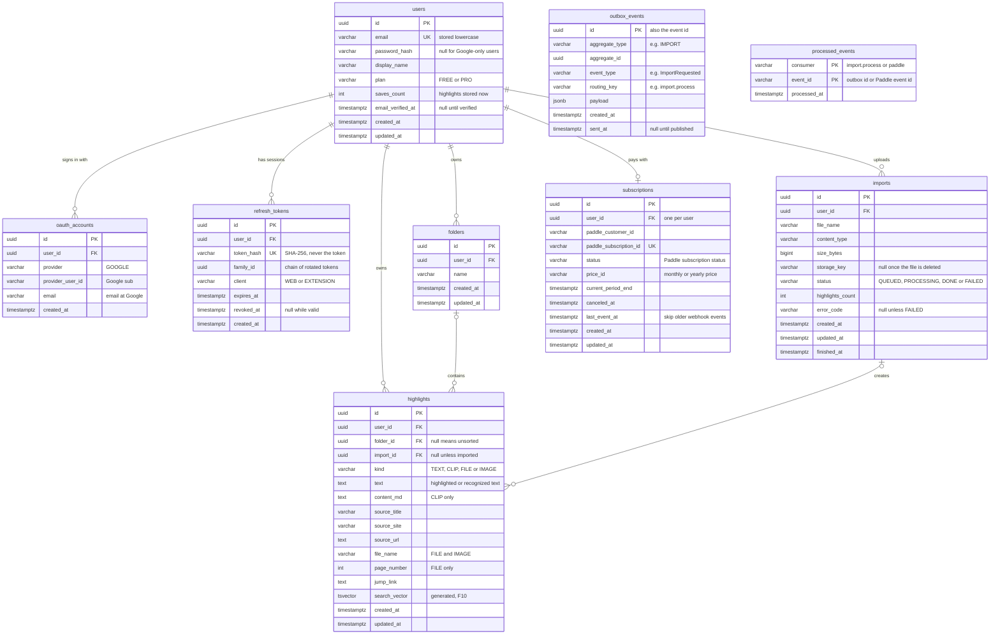

# Ari database

Last updated 2026-10-08. Keep this file identical in both repos. PostgreSQL 18, migrations with
Liquibase, queries with MyBatis (F8). Until F8, the in-memory repositories hold the same fields.
The flows that use these tables are in [sequences.md](sequences.md).

## 1. Tables and relations

`outbox_events` and `processed_events` stand alone: they point at other rows through their payload
and ids, not through foreign keys.

## 2. Columns and constraints

All ids are UUIDs created in code. All times are `timestamptz` in UTC, and `created_at` and
`updated_at` default to `now()`.

| Table | Column details and constraints |
|---|---|
| `users` | `email varchar(320)` unique, always trimmed and lowercased in code. `password_hash varchar(100)` nullable. `display_name varchar(100)`. `plan varchar(10)` default `FREE`, check `FREE`/`PRO`. `saves_count int` default 0, check `>= 0` |
| `oauth_accounts` | FK `user_id` → `users.id` on delete cascade. `provider varchar(20)`. `provider_user_id varchar(255)`. Unique `(provider, provider_user_id)` and unique `(user_id, provider)` |
| `refresh_tokens` | FK `user_id` → `users.id` on delete cascade. `token_hash varchar(64)` unique. `client varchar(20)`, check `WEB`/`EXTENSION`. Indexes on `user_id` and `family_id`. The 10-second reuse grace counts from `revoked_at` |
| `folders` | FK `user_id` → `users.id` on delete cascade. `name varchar(100)`, trimmed, unique `(user_id, lower(name))`. A folder's highlight count is a `COUNT(*)`, not a stored column |
| `highlights` | FK `user_id` → `users.id` on delete cascade. FK `folder_id` → `folders.id` on delete set null. FK `import_id` → `imports.id` on delete set null. `kind varchar(10)`, check `TEXT`/`CLIP`/`FILE`/`IMAGE`. `text` not null (for `CLIP`, a plain-text copy for search). `source_title varchar(500)`, `source_site varchar(255)`, `file_name varchar(255)`, `page_number int` check `> 0`. Index `(user_id, created_at desc, id desc)` for cursor paging, index on `folder_id` |
| `imports` | FK `user_id` → `users.id` on delete cascade. `file_name varchar(255)`, `content_type varchar(100)`, `storage_key varchar(512)`. `status varchar(12)` default `QUEUED`, check `QUEUED`/`PROCESSING`/`DONE`/`FAILED`. `highlights_count int` default 0. `error_code varchar(50)`. Index `(user_id, created_at desc)` |
| `subscriptions` | FK `user_id` → `users.id` on delete cascade, unique. `paddle_customer_id varchar(50)`, `paddle_subscription_id varchar(50)` unique, `status varchar(20)`, `price_id varchar(50)` |
| `outbox_events` | `aggregate_type varchar(50)`, `event_type varchar(100)`, `routing_key varchar(100)`, `payload jsonb` not null. Partial index on `created_at` where `sent_at is null`, for the publisher. A scheduled job deletes sent rows older than 7 days |
| `processed_events` | Primary key `(consumer, event_id)`. `consumer varchar(50)`, `event_id varchar(100)`. A scheduled job deletes rows older than 30 days |

Search (F10) adds to `highlights`:

- `search_vector tsvector` generated always from `text` and `source_title`, with the `simple`
  config and an IMMUTABLE wrapper around `unaccent`, plus a GIN index on it.
- `pg_trgm` and a GIN trigram index (`gin_trgm_ops`) on `text` for short or partial queries.

## 3. Plan and saves

- `users.plan` and `users.saves_count` decide the free limit; the JWT `plan` claim is never used for
  it ([sequences §5](sequences.md#5-save-and-delete-a-highlight-free-limit-f3-f4)).
- `saves_count` is the number of the user's highlights right now. It changes in the same transaction
  as every insert and delete, so Free means at most 500 stored at once.
- `subscriptions.status` drives `users.plan` in the same transaction: `active`, `trialing` and
  `past_due` → `PRO`; `paused` and `canceled` → `FREE`
  ([sequences §8](sequences.md#8-paddle-checkout-and-webhook-f15)).

## 4. Changesets

Files in `resources/db/changelog/v1/`, included in order from the master file. Never edit an applied
file; add a new one instead.

| File | Feature |
|---|---|
| `001-create-users.yaml` | F8 |
| `002-create-oauth-accounts.yaml` | F8 (used by F9) |
| `003-create-refresh-tokens.yaml` | F8 |
| `004-create-folders.yaml` | F8 |
| `005-create-imports.yaml` | F8 |
| `006-create-highlights.yaml` | F8 (after `imports`, for its FK) |
| `007-add-highlight-search.yaml` | F10 |
| `008-create-outbox-and-processed-events.yaml` | F11 |
| `009-create-subscriptions.yaml` | F15 |
