# Ari diagrams

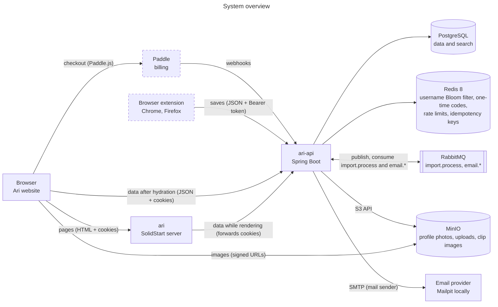

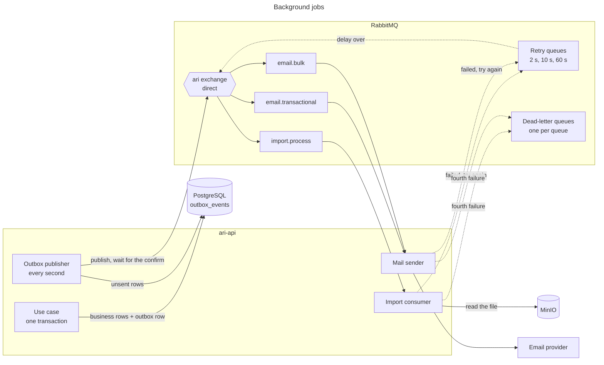

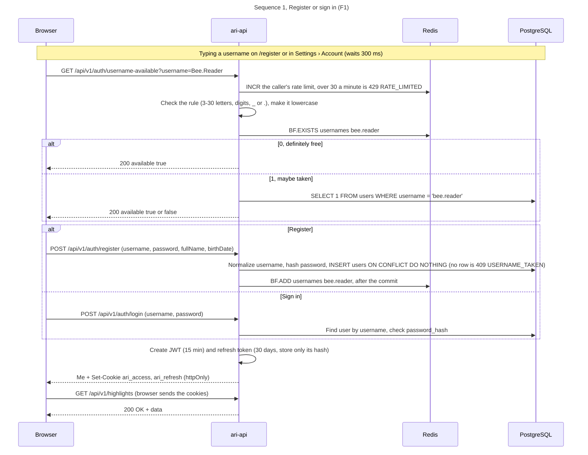

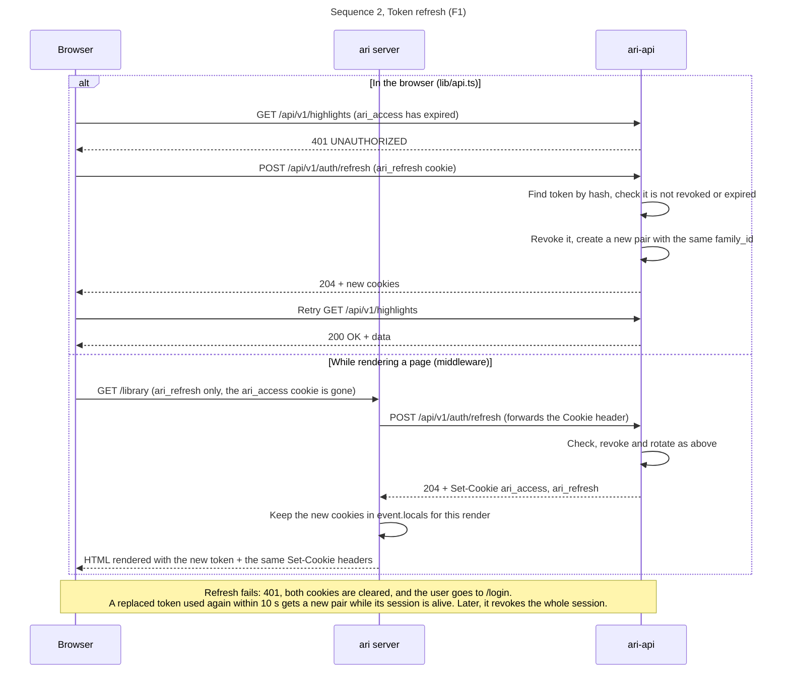

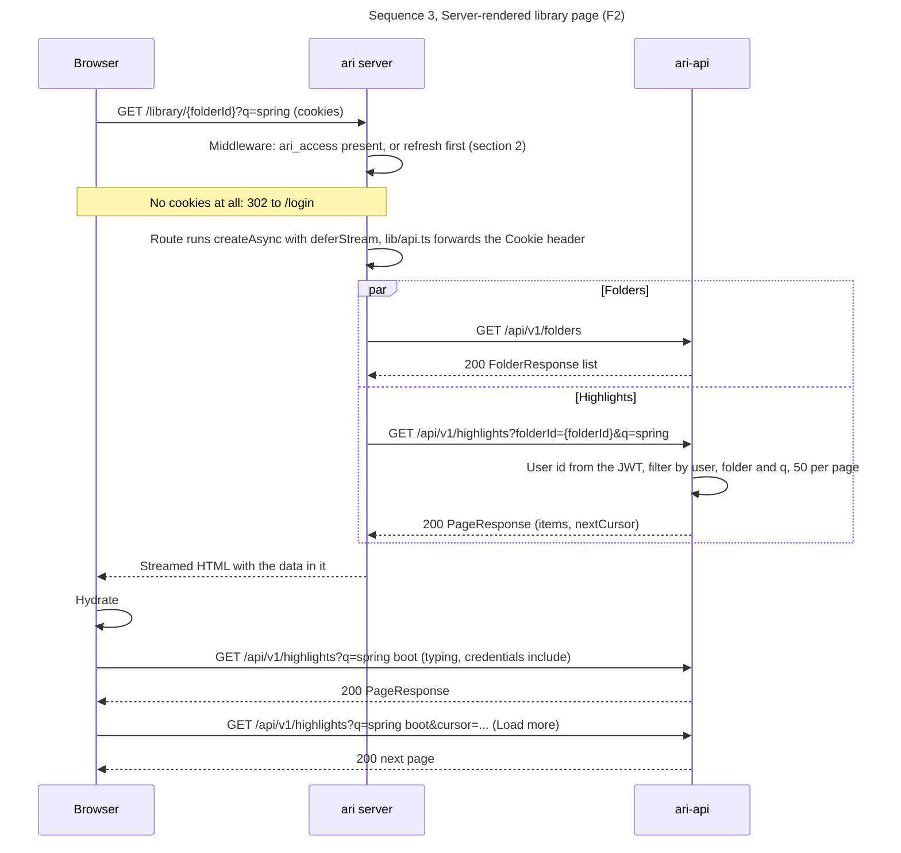

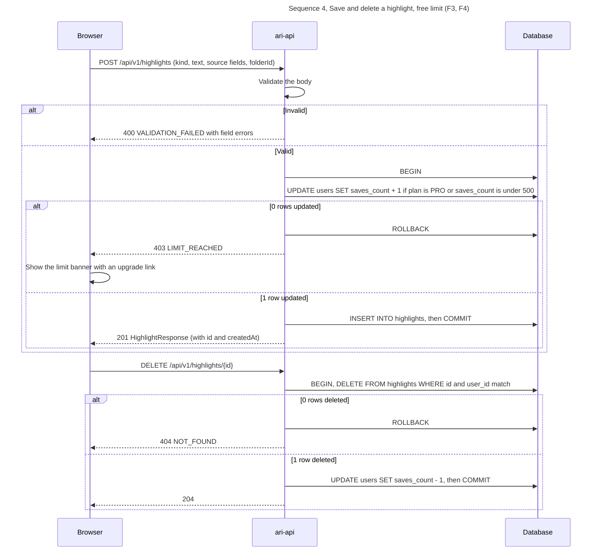

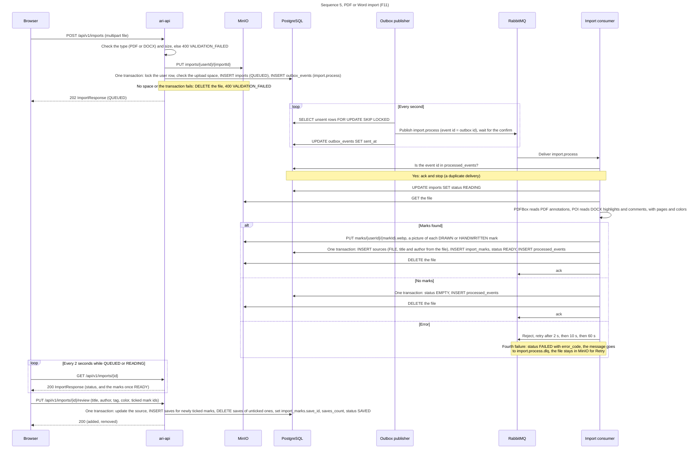

```mermaid
---
title: "Sequence 6, Save from the extension (F13)"
---
sequenceDiagram
  participant X as Extension
  participant T as Website tab
  participant A as ari-api
  participant R as Redis
  Note over X,R: Connect, on any signed-in page of the website
  T->>X: postMessage signed-in (the user's id)
  X->>T: postMessage want-code (not signed in as that user)
  T->>A: POST /api/v1/me/extension-code (cookies)
  A->>R: Store the code's hash with the user id, 60 s, single use
  A-->>T: 200 with the code
  T->>X: postMessage code
  X->>A: POST /api/v1/auth/extension/token (code)
  A->>R: GETDEL the code
  alt Missing, expired or used
    A-->>X: 401 INVALID_CODE
  else Found
    A->>A: Create JWT and refresh token (client EXTENSION)
    A-->>X: 200 accessToken, refreshToken
    X->>X: Keep the tokens in browser.storage.local
  end
  Note over X,R: Or another account, on the website's /extension/sign-in
  T->>A: POST /api/v1/auth/extension/code (username, password; no cookies change)
  A-->>T: 200 with the code, or 401 INVALID_CREDENTIALS
  T->>X: postMessage account-code
  X->>A: POST /api/v1/auth/extension/token (code), as above
  X->>T: postMessage connected
  Note over X,R: Save a highlight
  X->>A: POST /api/v1/saves (Bearer token, kind HIGHLIGHT, color, text, tags, source)
  A->>A: Same validation and steps as section 4
  A-->>X: 201 SaveResponse
  Note over X,R: Access token expired
  X->>A: POST /api/v1/auth/extension/refresh (refreshToken)
  A-->>X: 200 new pair (same rotation rules as the cookies)
  Note over X,R: Log out on the website (while it follows it), or in the extension
  T->>X: postMessage signed-out
  X->>A: POST /api/v1/auth/extension/logout (refreshToken)
  A-->>X: 204, the extension's session ends
```

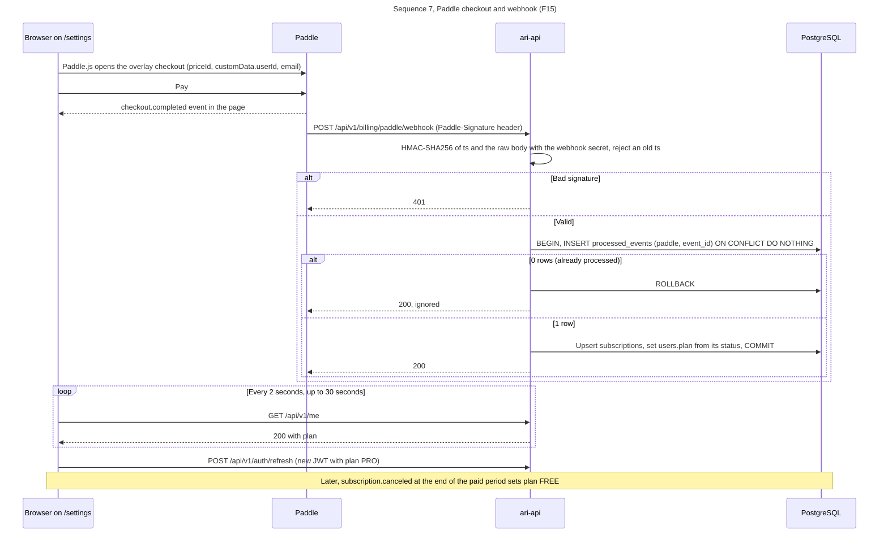

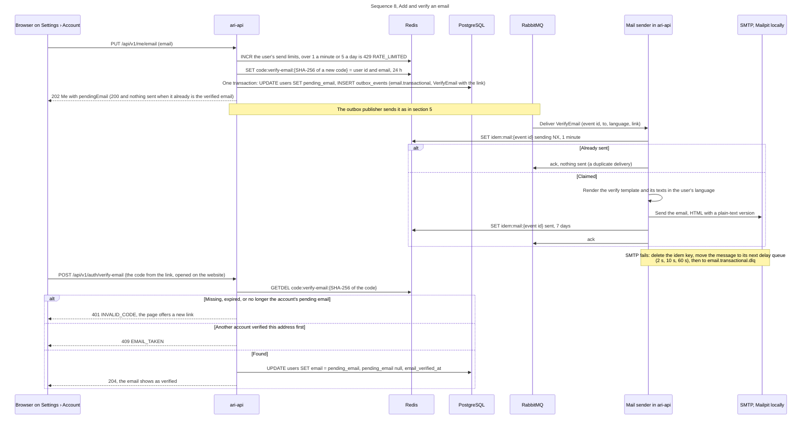

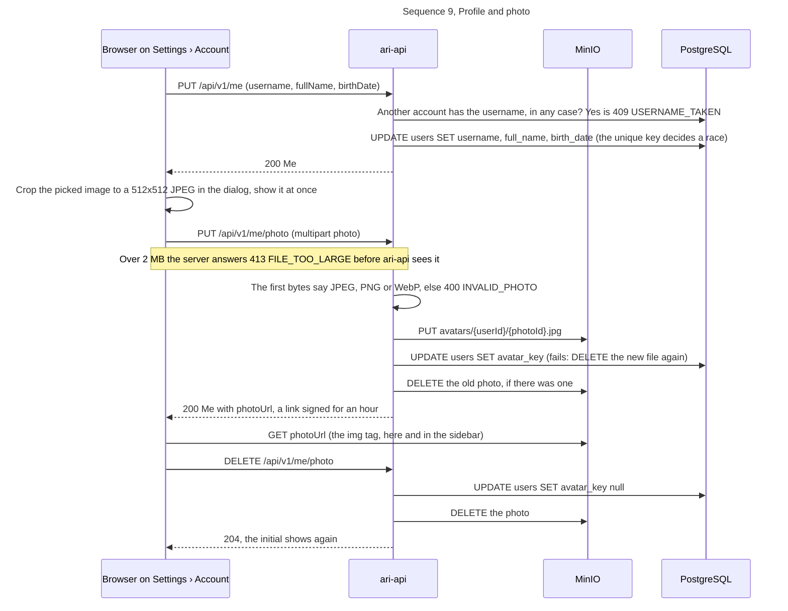

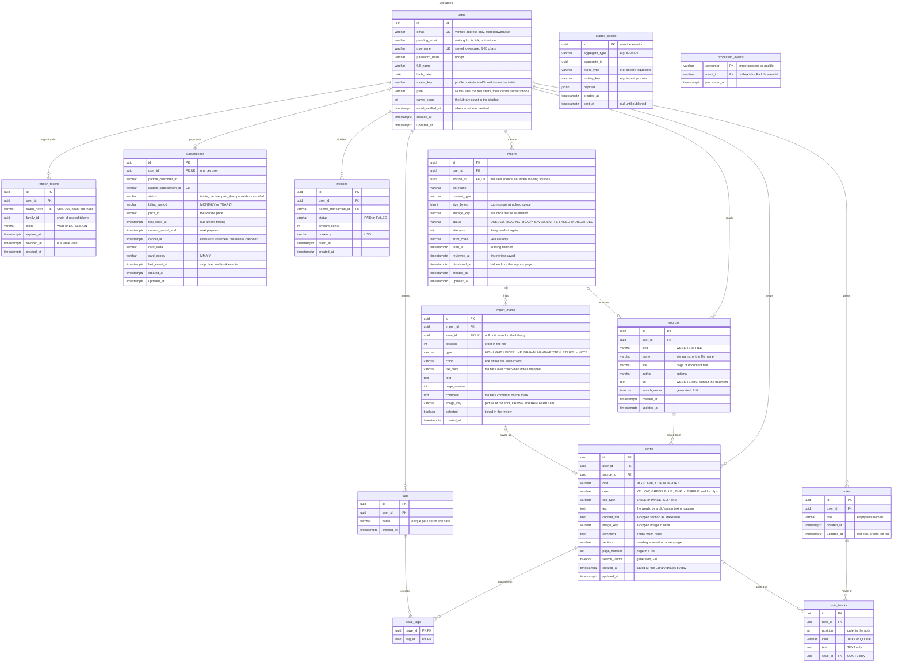

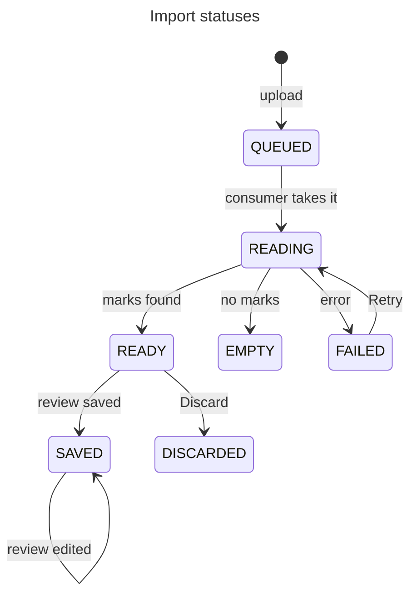

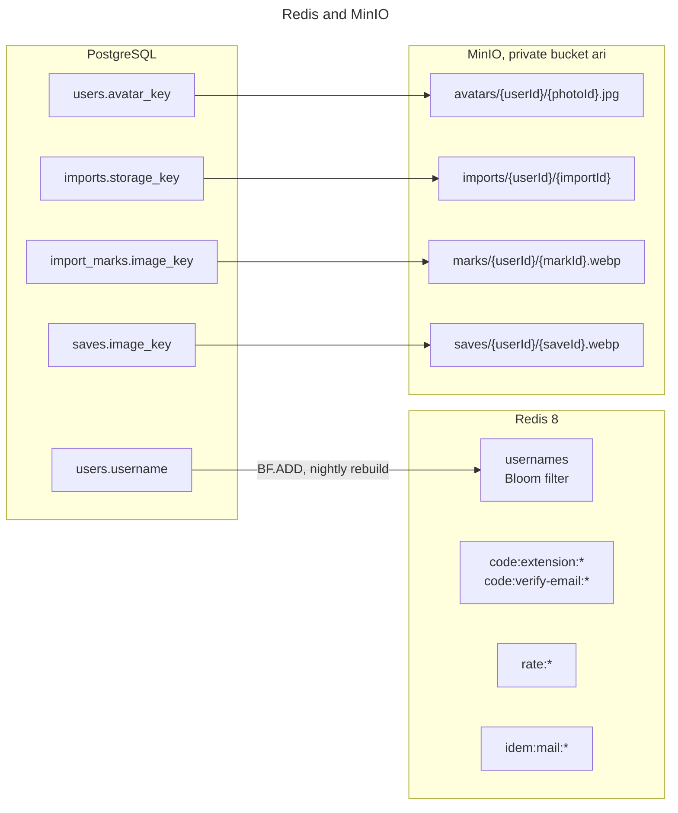
