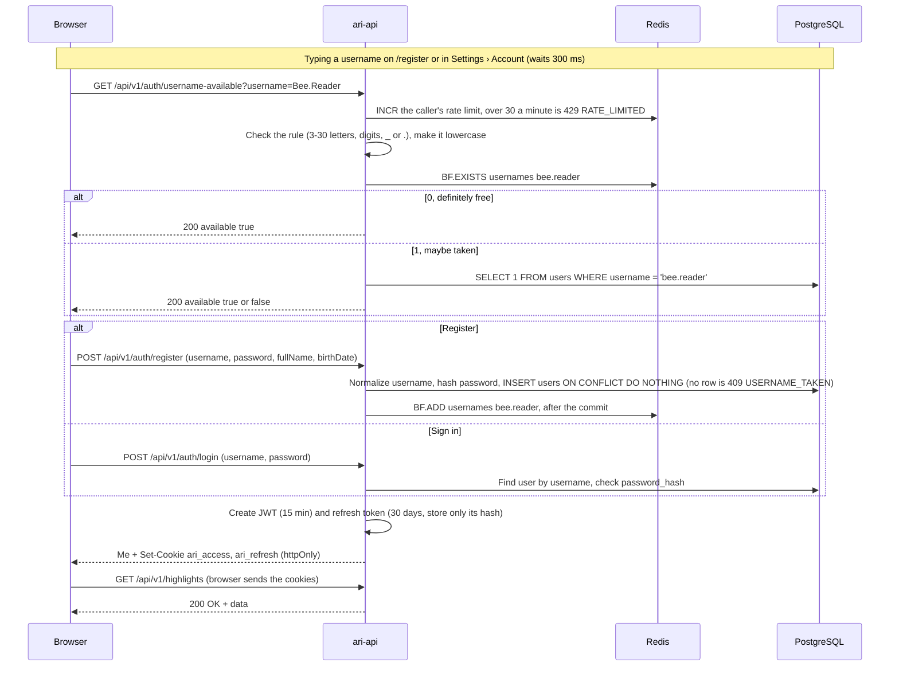
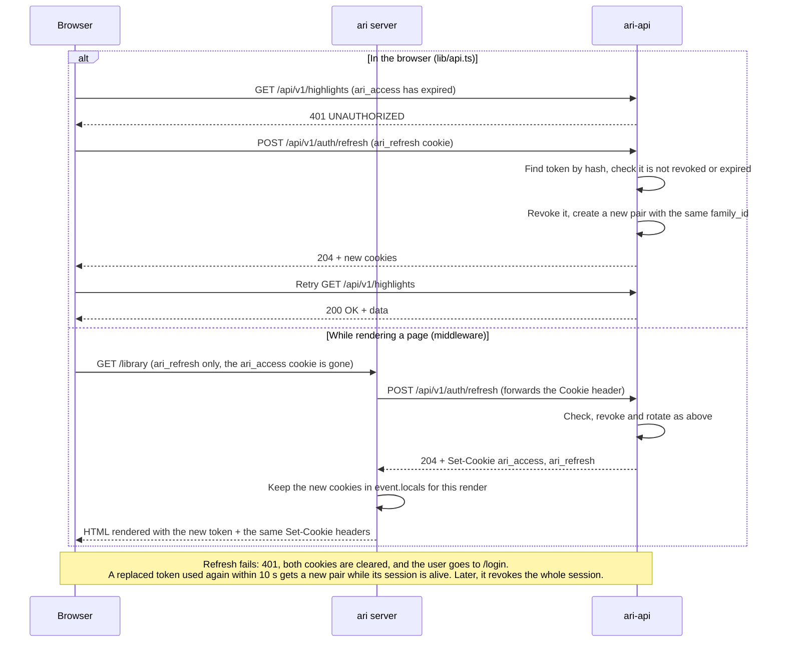
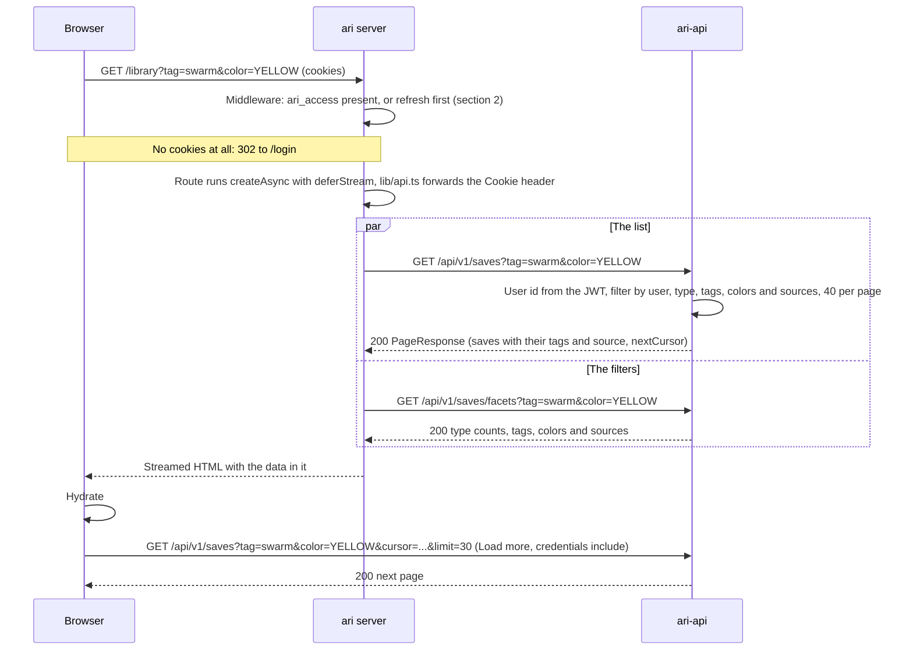
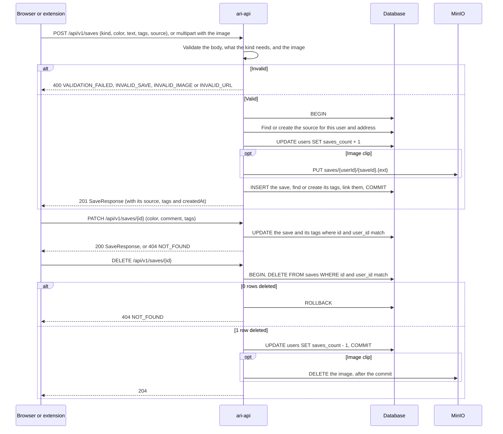
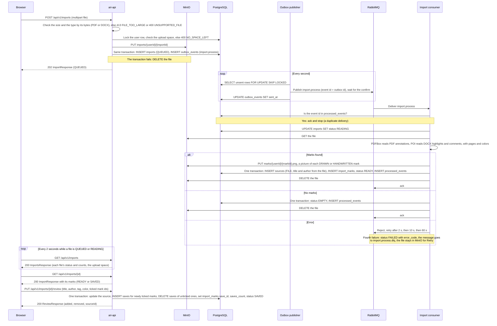
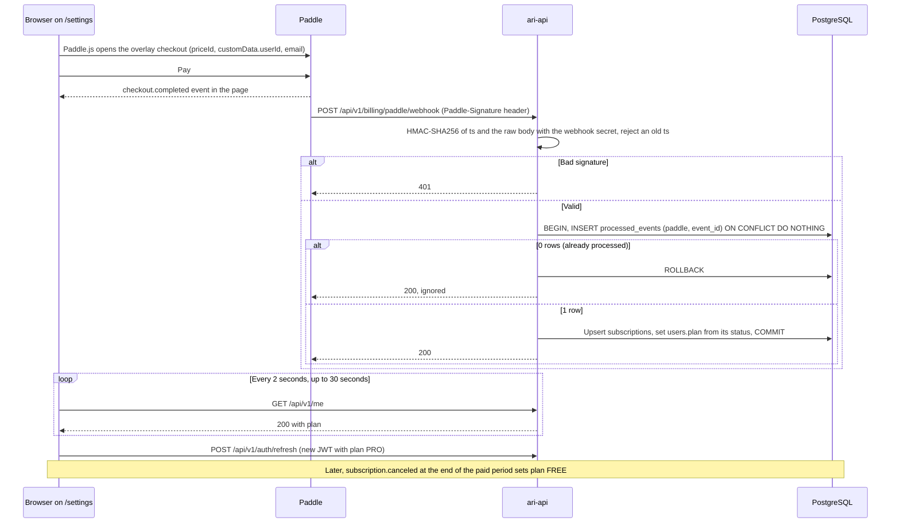
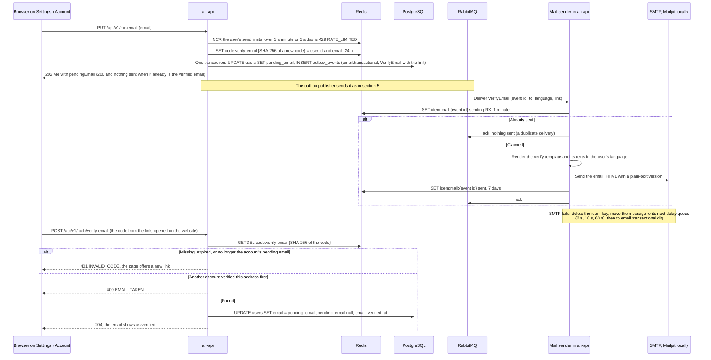
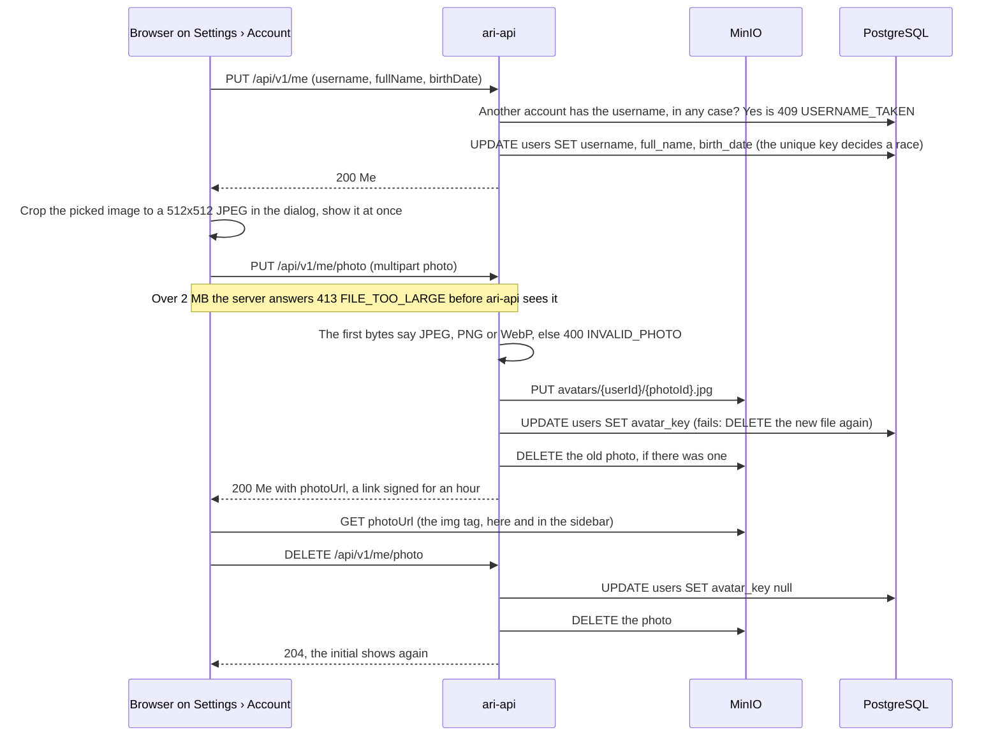
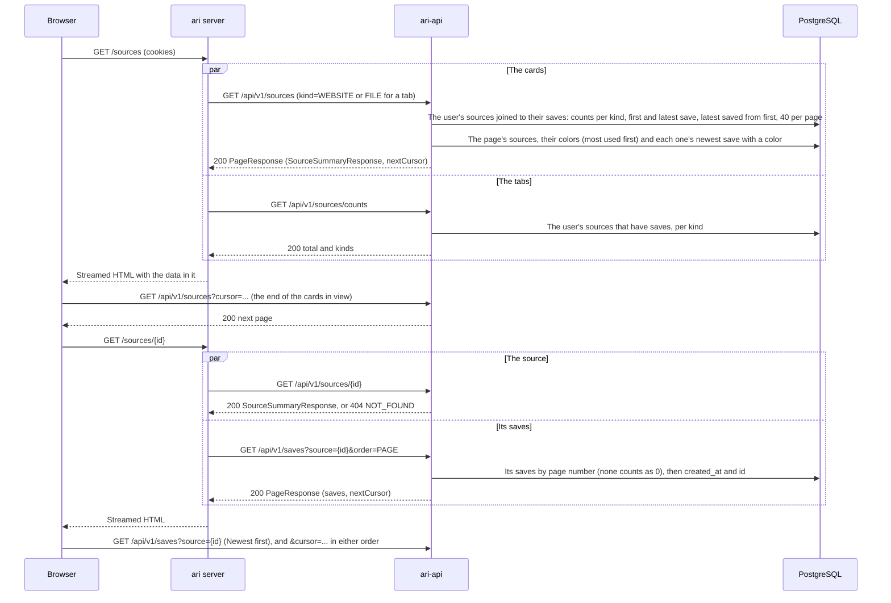
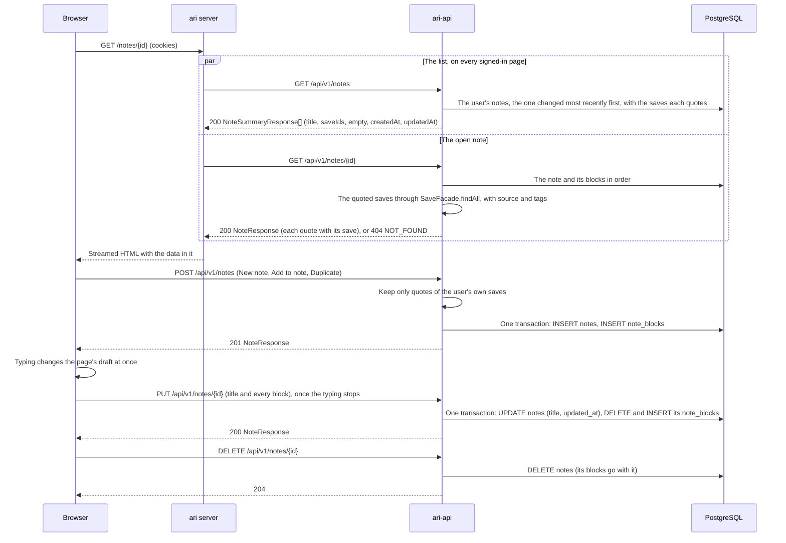

# Ari sequences

Last updated 2026-10-14. The `ari` repo keeps its own copy with only the client side; this one also
shows the server steps. The sign-in rules and error codes are in [architecture.md](architecture.md);
the tables, Redis keys and MinIO objects are in [database.md](database.md).

1. [Register or sign in (F1)](#1-register-or-sign-in-f1)
2. [Token refresh (F1)](#2-token-refresh-f1)
3. [Server-rendered library page (F2)](#3-server-rendered-library-page-f2)
4. [Save, change and delete a save (F3)](#4-save-change-and-delete-a-save-f3)
5. [PDF or Word import (F11)](#5-pdf-or-word-import-f11)
6. [Save from the extension (F13)](#6-save-from-the-extension-f13)
7. [Paddle checkout and webhook (F15)](#7-paddle-checkout-and-webhook-f15)
8. [Add and verify an email](#8-add-and-verify-an-email)
9. [Profile and photo](#9-profile-and-photo)
10. [Sources page](#10-sources-page)
11. [Notes](#11-notes)
12. [Reset a forgotten password](#12-reset-a-forgotten-password)

## 1. Register or sign in (F1)



- The Bloom filter answers "definitely free" or "maybe taken". Only "maybe taken" asks the
  database, so a free name costs a query only for the filter's 0.1% false positives. The unique key
  on `users.username` still decides at register; the filter is never the only check.
- A Bloom filter can't remove a name: a changed or deleted username stays in it, and the database
  check answers correctly until the nightly rebuild drops it.
- When the `usernames` key is missing (a new Redis), `ari-api` creates it with
  `BF.RESERVE usernames 0.001 1000000 EXPANSION 2` and adds every username with `BF.MADD`, 1,000 at a
  time. The nightly rebuild fills a new key the same way and `RENAME`s it over the old one; a name
  registered during the rebuild may be missing until the next one, which the unique key covers.
- If Redis is down, the check goes straight to the database.
- The check shows anyone whether a username is taken, as register's 409 already does, so it is
  rate-limited. Login still answers `INVALID_CREDENTIALS` for every failure.

## 2. Token refresh (F1)



- In the browser, several 401s at once share one refresh request.
- The `ari` server refreshes only when `ari_access` is missing. The cookie expires a minute before its
  JWT, so a cookie the browser still sends is always valid.

## 3. Server-rendered library page (F2)



- `ari-api` always filters by the signed-in user. A source id that belongs to someone else matches
  nothing; it is not an error.
- Filters (`type`, and repeated `tag`, `color` and `source`): a save may match any one value of a
  group, and must match every group that is given. Tag names are compared in any case.
- `nextCursor` is opaque: the last save's `(created_at, id)`, base64url-encoded. The next page
  holds the saves older than it (keyset paging, no `OFFSET`), so saves made at the same moment are
  neither skipped nor repeated. It is left out on the last page. A cursor the API did not make is
  400 `INVALID_CURSOR`. The page size is 40 unless `limit` (1 to 100) says otherwise.
- `facets` has two kinds of counts. The type tabs (`types`, `total`) count the saves that match the
  tag, color and source filters, so they change as you filter. `tags`, `colors` (all five, 0
  included) and `sources` count over the whole Library, so choosing one doesn't make the others
  disappear. A tag no save uses any more is not listed.
- `order=PAGE` lists the saves in page order instead, for a source's page (section 10).
- `q` searches (F10), on the list and the facets: every word must start a word of the save's text,
  comment or section (`search_vector @@ to_tsquery('simple', 'swarm:* & nest:*')`, over a GIN
  index), or of its source's name, title or author (`SourceFacade.findIdsMatching`, then
  `source_id IN`); or the whole query is part of the text (`LIKE` over a trigram index). Both sides
  lose their accents (`ari_unaccent`). Results stay newest first, so the cursor works as without a
  search.
- The reading view (`/library/{id}`) loads one save with `GET /api/v1/saves/{id}`: the same
  `SaveResponse`, or 404 `NOT_FOUND` when there is no such save or it is someone else's.

## 4. Save, change and delete a save (F3)



- What a kind needs is checked in code and again by the database: a `HIGHLIGHT` has a color and
  nothing else; a `CLIP` has no color and a `clipType`, a `TABLE` its `contentMd`, an `IMAGE` its
  picture. An `IMPORT` is only made by importing a file (F11), never posted.
- The source is found by `(user, address)`, with the `#fragment` dropped and the scheme and host in
  lowercase, so saving from the same page again reuses it and refreshes its name, title and (when
  given) author. Deleting the last save from a source leaves the source in place; the Sources page
  hides sources without saves.
- The counter changes in the same transaction as the insert or delete, so it cannot drift. There is
  no limit on saves: whether the user may save at all (plan `HIVE`) is checked once billing exists
  (F15).
- An image clip is one multipart request: the `save` part is the JSON body, the `image` part a JPEG,
  PNG or WebP of at most 2 MB, recognized by its bytes. The file is stored before the row that points
  at it and removed again if the save fails; on delete it is removed only after the commit.
- Tags are names. The ones the user doesn't have yet are created (names that differ only in case are
  one tag, and the first spelling stays); `PATCH` replaces a save's whole list.

## 5. PDF or Word import (F11)



- The file is in MinIO before the transaction commits, so the consumer never gets a job without
  its file. If the transaction fails, the file is deleted again. The space is checked before the
  file is stored, with the user's row locked, so two uploads at once can't both take the last of it.
- The outbox row is written in the same transaction as the import row, so a job is never lost. The
  publisher can send a message twice (a crash after publishing, before `sent_at`); the
  `processed_events` check makes that harmless.
- The retry queues and the dead-letter queue are drawn in
  [architecture §1.1](architecture.md#11-background-jobs). The import consumer runs inside
  `ari-api`, the only service that reads the database.
- Retry (`POST /imports/{id}/retry`) sets `QUEUED`, adds one to `attempts` and writes a new outbox
  row. Discard deletes the file, the marks, their pictures and the file's source. Dismissing a
  `FAILED`, `EMPTY` or `DISCARDED` import (`POST /imports/{id}/dismiss`) sets `dismissed_at` and
  deletes a file still in MinIO. Discard is `DELETE /imports/{id}`, for a `READY` import only.
- A file that can never be read (damaged, or a PDF with a password) skips the retries: it is
  `FAILED` at once with `UNREADABLE` or `ENCRYPTED`; one that fails every retry gets `READ_FAILED`.
- Saving a handwritten mark copies its picture to `saves/{userId}/{saveId}.png`, so every MinIO
  object belongs to exactly one row. Pictures are PNG: Java's ImageIO writes no WebP.
- Readers: PDFBox takes highlights, underlines (and squiggles), strike-outs, sticky and typed notes,
  and drawings (ink, boxes, circles, polygons) with the page's text under them; a drawing over no
  text is `HANDWRITTEN`. POI takes Word's highlights (and colored shading), strike-throughs and
  comments; a comment on a highlight becomes its comment, on other text a `NOTE`. Word files give
  page numbers only where Word noted its page breaks.
- Photos are not read here: OCR runs in the browser (F12).

## 6. Save from the extension (F13)

```mermaid
sequenceDiagram
  participant X as Extension
  participant T as Website tab
  participant A as ari-api
  participant R as Redis
  Note over X,R: Connect, on any signed-in page of the website
  T->>X: postMessage signed-in (the user's id)
  X->>T: postMessage want-code (not signed in as that user)
  T->>A: POST /api/v1/me/extension-code (cookies)
  A->>R: Store the code's hash with the user id, 60 s, single use
  A-->>T: 200 with the code
  T->>X: postMessage code
  X->>A: POST /api/v1/auth/extension/token (code)
  A->>R: GETDEL the code
  alt Missing, expired or used
    A-->>X: 401 INVALID_CODE
  else Found
    A->>A: Create JWT and refresh token (client EXTENSION)
    A-->>X: 200 accessToken, refreshToken
    X->>X: Keep the tokens in browser.storage.local
  end
  Note over X,R: Or another account, on the website's /extension/sign-in
  T->>A: POST /api/v1/auth/extension/code (username, password; no cookies change)
  A-->>T: 200 with the code, or 401 INVALID_CREDENTIALS
  T->>X: postMessage account-code
  X->>A: POST /api/v1/auth/extension/token (code), as above
  X->>T: postMessage connected
  Note over X,R: Save a highlight
  X->>A: POST /api/v1/saves (Bearer token, kind HIGHLIGHT, color, text, tags, source)
  A->>A: Same validation and steps as section 4
  A-->>X: 201 SaveResponse
  Note over X,R: Access token expired
  X->>A: POST /api/v1/auth/extension/refresh (refreshToken)
  A-->>X: 200 new pair (same rotation rules as the cookies)
  Note over X,R: Log out on the website (while it follows it), or in the extension
  T->>X: postMessage signed-out
  X->>A: POST /api/v1/auth/extension/logout (refreshToken)
  A-->>X: 204, the extension's session ends
```

- The code is 32 random bytes, base64url-encoded; Redis keeps only its SHA-256. The website asks
  for it under `/me` with its cookies, because `/api/v1/auth/**` reads no token. A signed-out tab
  posts nothing: the extension's Sign in opens `/library`, which goes to `/login` first and back.
- The messages go through `window.postMessage` to the website's own origin, and the extension's
  content script takes them only on that origin, so no other site can sign it in as somebody else.
- By default the extension uses the website's account and follows it: to another account, and out
  when the website logs out in the same browser. On the website's `/extension/sign-in` it can sign
  in as any account with a password instead (`POST /auth/extension/code` sets no cookies, and the
  website stays as it is); it keeps that account, whatever the website does, until it logs out.
- The extension's session is its own: the website's cookies may expire while it stays signed in.
  Each refresh gives it 30 more days. Refresh tokens are checked against their client: the cookie refresh
  takes only `WEB` tokens, the extension's refresh only `EXTENSION` ones, and its 401 clears no
  cookies.
- `ari-api` reads the `ari_access` cookie first, then the `Authorization` header, so every endpoint
  works for the extension. The extension sends no cookies (`credentials: 'omit'`), so its token is
  the one read.
- The extension calls `ari-api` from its background script. Firefox sends those requests with
  `Origin: moz-extension://<uuid>`, a uuid of each install, so CORS allows `moz-extension://*` and
  `chrome-extension://*` by pattern, without credentials.
- The extension sends the page's address as `source.url`; a text-fragment jump link may be sent as
  it is, because the `#fragment` is dropped. The link that opens the page at the save is built by
  the website from `source.url` and `text`, so nothing like it is stored. Clips (F14) use the same
  `POST /saves`: a table with `kind CLIP` and `contentMd`, an image as multipart.

## 7. Paddle checkout and webhook (F15)



- Events handled: `subscription.created`, `subscription.updated`, `subscription.canceled`. The first
  one finds the user through `custom_data.userId`; later ones through `paddle_subscription_id`.
- Status to plan: `active`, `trialing` and `past_due` → `PRO`; `paused` and `canceled` → `FREE`.
- The signature header looks like `ts=...;h1=...`. Verify `h1` against HMAC-SHA256 of `ts:rawBody`,
  reject a `ts` older than 5 seconds, and read the raw body before parsing JSON. The endpoint is
  public; the webhook secret comes from the `PADDLE_WEBHOOK_SECRET` environment variable.
- Paddle can send events out of order: skip an event older than `subscriptions.last_event_at`.
- Downgrading deletes nothing. A Free user above 500 keeps every highlight but can't save until under
  500.
- Prices: Pro is $6/month or $48/year, the same everywhere.

## 8. Add and verify an email



- `users.email` holds only a verified address, so changing it keeps the old one working for
  password resets until the new link is opened. `pending_email` is not unique: nobody can block an
  address by adding it and never confirming it.
- Whether an address is taken is checked only when its link is opened, by the unique key on
  `users.email`. Adding an email never reveals whether it belongs to another account; only someone
  who can read that inbox learns it.
- Resend (`POST /me/email/resend`) sends a new link for the pending email under the same limits
  (400 `BAD_REQUEST` when none is waiting); older links for that address work until they expire.
  Remove (`DELETE /me/email`) clears both columns. Both need a signed-in user; verify is public,
  so the website calls it with `refresh: false`.
- The code is 32 random bytes, base64url-encoded, in the link; Redis keeps only its SHA-256, for 24
  hours, and `GETDEL` makes it single use.
- The language comes from the request's `ari_lang` cookie and travels in the message. Locally the
  website and the API share `localhost`, so the browser sends it; in production the website must
  set `ari_lang` on the shared parent domain like the sign-in cookies (F16), or every email is in
  English.
- A delivery that finds `sending` (another delivery is working on the event, or crashed less than a
  minute ago) goes to the next delay queue and tries again, so a crash never loses the email and a
  repeat never sends it twice. A job that can never be sent (unknown type, no recipient, a body
  that isn't JSON) goes straight to the `.dlq`.
- The mail sender is `feature/mail` inside `ari-api`. It reads no table, owns the Thymeleaf
  templates (`resources/templates/mail/`), and sends over SMTP: Mailpit locally, whose inbox is
  http://localhost:8025.
- The outbox payload holds the link until the row is deleted, 7 days after it was sent.

## 9. Profile and photo



- The photo is never one transaction with the row: the file goes to MinIO first, then a single
  update points at it, and the file the row stopped pointing at is deleted last.
- The format comes from the bytes, never from the upload's content type, so a renamed file is
  turned down.
- Changing the username keeps the session: the access token holds the user id, not the username.

## 10. Sources page



- `GET /sources?q=` searches: every word must start a word of the source's name, title or author
  (`sources.search_vector`). The website's search palette uses it.
- A source with nothing saved from it any more is left out of the list and the counts, and
  `GET /sources/{id}` answers 404 `NOT_FOUND` for it, as for an unknown id or someone else's.
- The source feature sums up the `saves` table in its own SQL, reading it but never writing it. It
  can't ask the save feature's facade, because that one already calls the source facade to find
  or create a save's source. Colors cross as text (`YELLOW` … `PURPLE`), since `HighlightColor` is
  the save feature's domain type.
- The list is in the order the sources were last saved from: keyset paging on (the latest save's
  time, id), base64url-encoded like the Library's cursor; 400 `INVALID_CURSOR` for one the API did
  not make.
- `order=PAGE` sorts by page number, then by the order they were saved in. A web page's saves have
  no page number, so they come in the order they were saved, which is usually the order they were
  read in. That cursor carries the page number too, and one made for either order is 400
  `INVALID_CURSOR` in the other.
- Each source lists the notes quoting its saves (`notes`: id, title, how many), the one changed
  most recently first: a join of `note_blocks`, `notes` and `saves` that the source feature only
  reads (section 11).

## 11. Notes



- A whole note goes with every save, and replaces what was there, so the website never has to
  merge block changes. It waits for the one save of a note to arrive before it sends the next, so
  an older one never lands last.
- A quote stores only its save's id. `GET /notes/{id}` answers each quote with the save as it is
  now (color, comment, source), and deleting a save deletes its quotes through the foreign key.
  A quote of a save that isn't the user's (deleted, or never theirs) is left out when the note is
  written, so a note never shows another user's save.
- 400 `INVALID_NOTE` when a block holds what its kind doesn't; `VALIDATION_FAILED` for a title
  over 200 characters, more than 1000 blocks or a paragraph over 20000 characters.
- `updatedAt` equals `createdAt` until the first edit, which is how the website tells "Created"
  from "Edited". `empty` is a note with no title, no quote and nothing but whitespace written.
- `GET /notes?q=` searches the title and the note's own writing: every word must start a word of
  them (from any paragraph), or the whole query is part of them. Each save writes `notes.body`,
  the paragraphs joined, with the blocks.

## 12. Reset a forgotten password

```mermaid
sequenceDiagram
  participant B as Browser on /forgot-password
  participant A as ari-api
  participant R as Redis
  participant D as PostgreSQL
  participant M as Mail sender
  participant I as The user's inbox
  participant P as Browser on /reset-password
  B->>A: POST /api/v1/auth/password-reset (login: a username or email)
  A->>R: INCR rate:password-reset:{address}; over 20 an hour is 429 RATE_LIMITED
  A->>D: The account with that verified email (an "@" in it) or username
  alt None
    A-->>B: 404 ACCOUNT_NOT_FOUND
  else No email, or it waits for its verify link
    A-->>B: 409 NO_EMAIL or EMAIL_NOT_CONFIRMED
  else Found
    A->>R: The account's email limits (1 a minute, 5 a day, with verify links)
    A->>R: SET code:password-reset:{SHA-256} (user id, expires in 30 minutes), kept 7 days
    A->>D: INSERT outbox_events (ResetPassword, in the ari_lang language)
    A-->>B: 204
    D-)M: The outbox sends it to email.transactional
    M-)I: "Reset your Ari password", with the link
  end
  I->>P: The user opens /reset-password?code=…
  P->>A: POST /api/v1/auth/password-reset/check (code), while the server renders
  A->>R: GET the code, EXISTS its used key
  A-->>P: 200 username, or 401 INVALID_CODE, 410 CODE_EXPIRED or CODE_USED
  P->>A: POST /api/v1/auth/password-reset/confirm (code, password)
  A->>R: SET NX code:password-reset-used:{SHA-256}; already there is 410 CODE_USED
  A->>D: UPDATE users SET password_hash; revoke every refresh token of the user
  A-->>P: 204
```

- Only the code's SHA-256 is stored. The code is kept a week though it works for 30 minutes, so an
  expired or used link says so instead of "doesn't work"; after that it is unknown.
- Checking never uses the code up; confirming marks it used with `SET NX`, so two confirms at once
  change the password once.
- A new password ends every session of the account, the website's and the extension's: the reason
  to reset may be that someone else has it.
- Asking says why no link was sent, which tells whether an account exists; usernames are public
  through `/auth/username-available` already, and the address limit keeps anyone from trying many.
