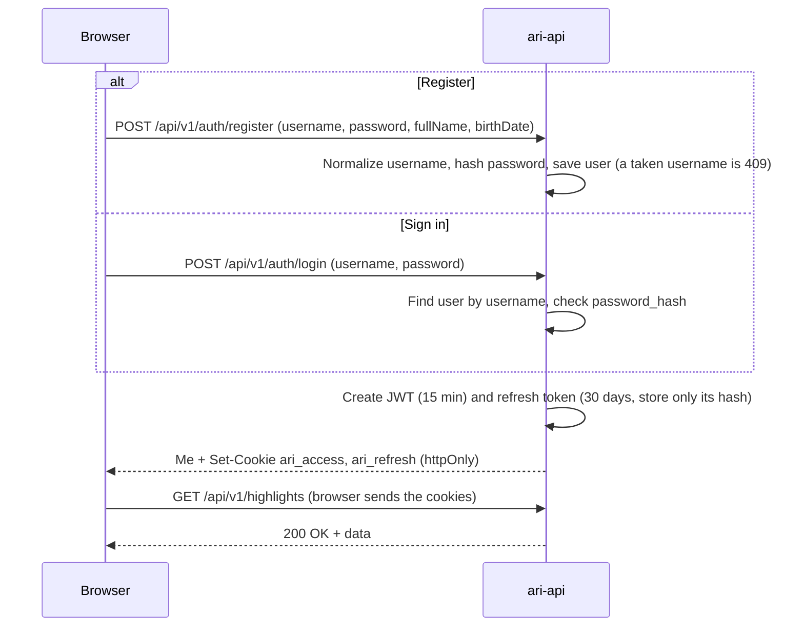
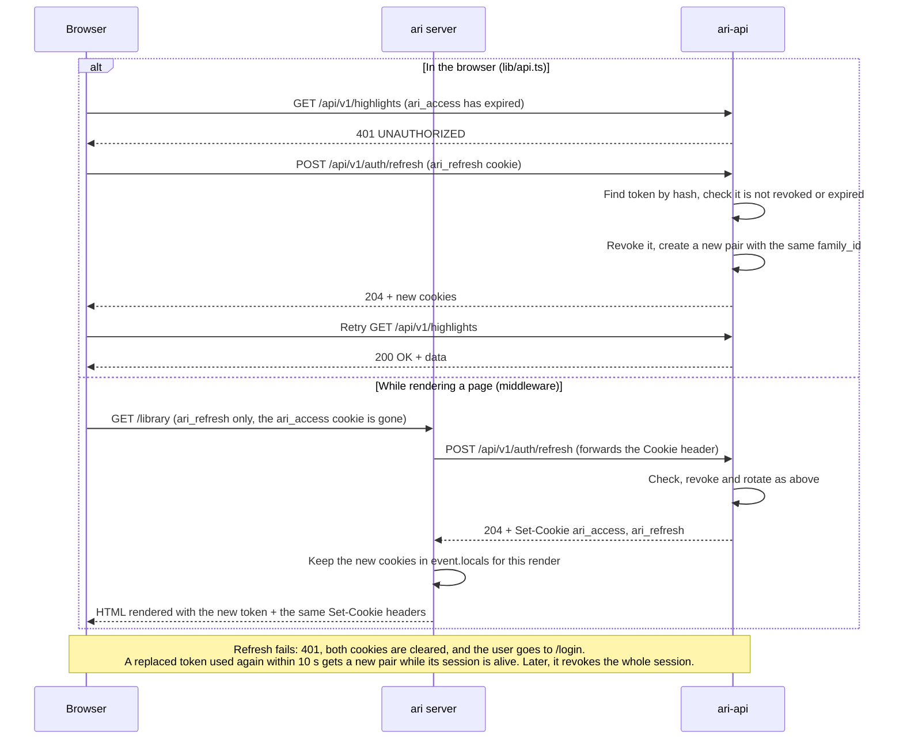
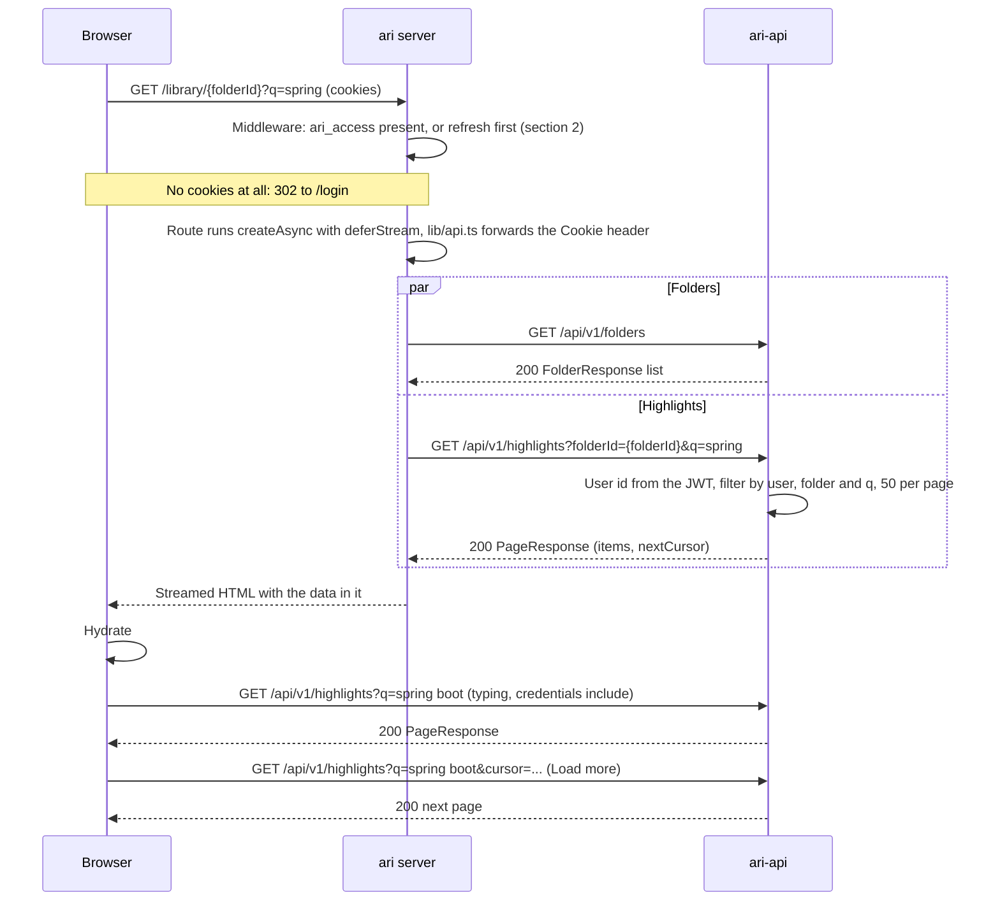
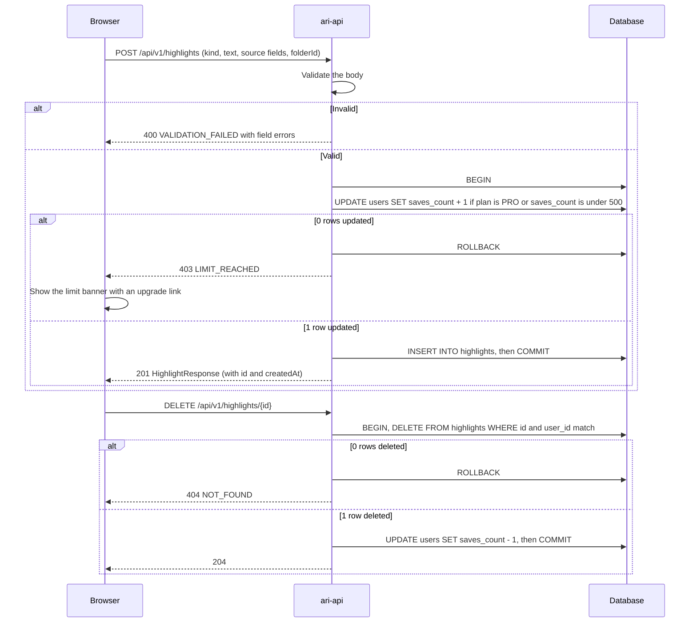
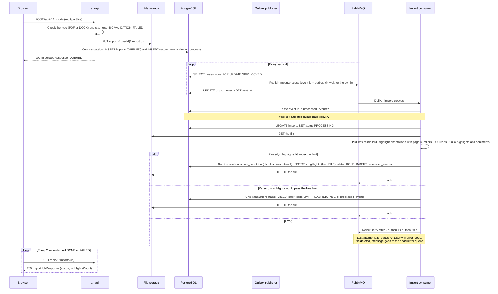
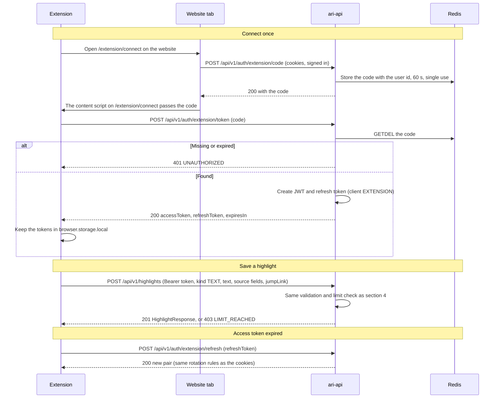
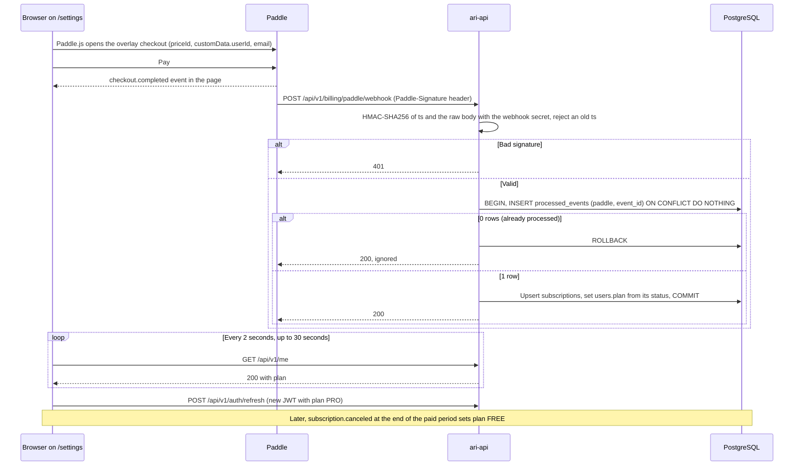

# Ari sequences

Last updated 2026-10-08. The `ari` repo keeps its own copy with only the client side; this one also
shows the server steps. The sign-in rules and error codes are in [architecture.md](architecture.md);
the tables are in [database.md](database.md).

1. [Register or sign in (F1)](#1-register-or-sign-in-f1)
2. [Token refresh (F1)](#2-token-refresh-f1)
3. [Server-rendered library page (F2)](#3-server-rendered-library-page-f2)
4. [Save and delete a highlight, free limit (F3, F4)](#4-save-and-delete-a-highlight-free-limit-f3-f4)
5. [PDF or Word import (F11)](#5-pdf-or-word-import-f11)
6. [Save from the extension (F13)](#6-save-from-the-extension-f13)
7. [Paddle checkout and webhook (F15)](#7-paddle-checkout-and-webhook-f15)

## 1. Register or sign in (F1)

## 2. Token refresh (F1)

- In the browser, several 401s at once share one refresh request.
- The `ari` server refreshes only when `ari_access` is missing. The cookie expires a minute before its
  JWT, so a cookie the browser still sends is always valid.

## 3. Server-rendered library page (F2)

- `ari-api` always filters by the signed-in user. A folder id that belongs to someone else returns
  404 `NOT_FOUND`.
- `nextCursor` is opaque: the last item's `(created_at, id)`, base64url-encoded. The next page holds
  the items older than it (keyset paging, no `OFFSET`). It is null on the last page.
- Typing in the search box waits about 300 ms, then updates `?q=` in the URL, so a reload renders the
  same results on the server.
- Phase 1 (F2) matches `q` case-insensitively against text and title in memory. F10 swaps in
  Postgres full-text search behind the same endpoint.

## 4. Save and delete a highlight, free limit (F3, F4)

- The limit check reads `users.plan` and `users.saves_count`, never the JWT `plan` claim, which can
  be up to 15 minutes old after an upgrade.
- The counter changes in the same transaction as the insert or delete, so it cannot drift.
- Free means at most 500 highlights stored at once: deleting gives the save back. Pro has no limit.
  Folders don't count.
- `GET /me` returns `plan`, `savesCount` and `savesLimit`; `/settings` shows them, and the banner shows
  once `savesCount` reaches `savesLimit`.
- Phase 1 (no database until F8): the same check and change run in memory under a per-user lock.

## 5. PDF or Word import (F11)

- The outbox row is written in the same transaction as the import row, so a job is never lost. The
  publisher can send a message twice (a crash after publishing, before `sent_at`); the
  `processed_events` check makes that harmless.
- If the first transaction fails, delete the stored file again.
- An import is all or nothing: if its highlights don't fit under the free limit, none are saved.
- Queues: `import.process`, plus one retry queue per delay (message TTL with a dead-letter exchange
  back to `import.process`) and `import.process.dlq`.
- F5 (mock, phase 1): `POST /imports` ignores the file and returns a `DONE` job with 0 highlights. No
  storage, outbox or queue.
- Photos are not imported here: OCR runs in the browser (F12) and saves through `POST /highlights`.

## 6. Save from the extension (F13)

- The code is 32 random bytes, base64url-encoded. If the tab is signed out, `/extension/connect`
  sends the user to `/login` first and then comes back.
- `ari-api` reads the `ari_access` cookie first, then the `Authorization` header, so every endpoint
  works for the extension.
- The extension calls `ari-api` from its background script, which has host permission for the API,
  so it needs no CORS entry.
- The extension builds `jumpLink` as a text-fragment URL (`#:~:text=`). Clips (F14) use the same
  `POST /highlights` with `kind CLIP` and `contentMd`.

## 7. Paddle checkout and webhook (F15)

- Events handled: `subscription.created`, `subscription.updated`, `subscription.canceled`. The first
  one finds the user through `custom_data.userId`; later ones through `paddle_subscription_id`.
- Status to plan: `active`, `trialing` and `past_due` → `PRO`; `paused` and `canceled` → `FREE`.
- The signature header looks like `ts=...;h1=...`. Verify `h1` against HMAC-SHA256 of `ts:rawBody`,
  reject a `ts` older than 5 seconds, and read the raw body before parsing JSON. The endpoint is
  public; the webhook secret comes from the `PADDLE_WEBHOOK_SECRET` environment variable.
- Paddle can send events out of order: skip an event older than `subscriptions.last_event_at`.
- Downgrading deletes nothing. A Free user above 500 keeps every highlight but can't save until under
  500.
- Prices: Pro is $6/month or $48/year, the same everywhere.
